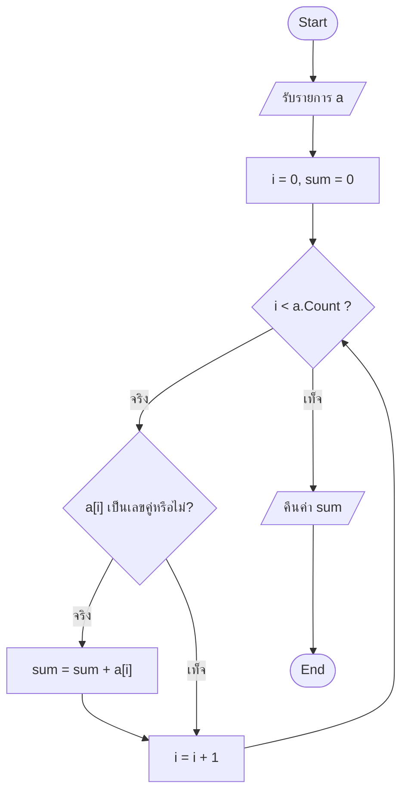
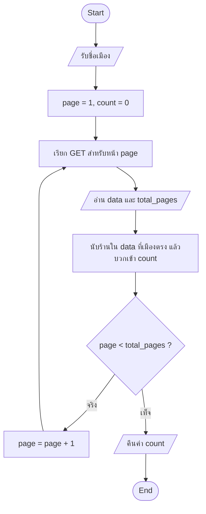

# เตรียม HackerRank และสัมภาษณ์ Backend ด้วย C# · โจทย์พร้อมเฉลย 34 ข้อและโจทย์เสริม 4 ข้อ

<a id="contents"></a>

**ถ้าอ่านครั้งแรก** เริ่มที่ภาค 1 แล้วต่อด้วยโจทย์ผสมในภาค 3 เมื่อเขียน Coding, API และ SQL ได้เอง ถ้าเปิดเพื่อหาคำสั่งใดคำสั่งหนึ่ง ให้ข้ามไป [ชีตคำสั่ง C#](#commands) หรือ [ดัชนีคำในโจทย์](#index) ได้ทันที

| ลำดับ | เนื้อหา |
|---|---|
| 1 · พื้นฐานที่ใช้สอบ | [Coding และ LINQ](#coding) → [REST API](#api) → [SQL](#sql) มีโจทย์ฝึกและเฉลยอยู่กับบทที่ใช้ |
| 2 · หัวข้อต่อยอด | [Algorithms](#algorithms) → [Data Structures](#structures) → [System Design](#design) → [Flowchart](#flowchart) เลือกตามหัวข้อที่อยากฝึก |
| 3 · โจทย์ผสม | [โจทย์ 31–34 พร้อมเฉลย](#mixed) → [ตรวจสาเหตุเมื่อผ่านเพียงบางเคส](#hidden) |
| 4 · เปิดทวน | [คำสั่ง Coding](#commands) · [LINQ](#linq-ref) · [LINQ ในงาน Backend](#linq-dev) · [เลือกคำสั่งเมื่อเจอโจทย์ใหม่](#unseen) · [HTTP และ JSON](#api-ref) · [ศัพท์อังกฤษและดัชนี](#index) |

## ภาค 1 · พื้นฐานและโจทย์สามหมวด

<a id="coding"></a>

### 1–9 · Coding ด้วย C#

ถ้าโจทย์ให้ `reverseArray(List<int> a)` ลองอ่านว่า “รับรายการเลขจำนวนเต็มเข้ามาหนึ่งรายการ ชื่อว่า a” เช่น `a = [1,4,3,2]` ข้อมูลมี 4 ตัว แต่เลขช่องหรือ **index** เริ่มที่ 0 ดังนั้น `a[0]` ได้ 1 และ `a[3]` ได้ 2 **array** (`int[]`) มีจำนวนช่องคงที่ ใช้ `Length` ดูความยาว ส่วน **List** (`List<int>`) เพิ่มสมาชิกด้วย `Add` ได้และใช้ `Count` ดูจำนวน ทั้งสองชนิดอ่านค่าด้วย `[index]` เหมือนกัน

**ลูปกับ LINQ อ่านต่างกันอย่างไร** ถ้าจะเลือกเลขคู่จากรายการนี้ ลูปสั่งว่า “หยิบมาทีละตัว ถ้าเป็นเลขคู่ให้เก็บไว้” ส่วน LINQ เขียนเงื่อนไขเป็น `a.Where(x => x % 2 == 0)` ลองแทน `x` ด้วยเลข 1 แล้ว 4 จะได้เท็จแล้วจริง ดังนั้นตัวแรกที่ผ่านคือ 4 ถ้าโจทย์ต้องการลิสต์ เติม `.ToList()` จะได้ `[4,2]` ลองอ่านแบบลูปก่อน แล้วค่อยเทียบกับแบบสั้นในข้อ 1

**วิธีใช้โค้ด** ตัวอย่างใช้ C# กับ `System`, `System.Collections.Generic`, `System.Linq`, `System.Net.Http`, `System.Net.Http.Json` และ `System.Threading.Tasks` ใส่ `using` ของ namespace ที่ใช้ด้านบนไฟล์ วางเมธอดในคลาส เช่น `Result` ชื่อเมธอดลงท้าย `Short` เป็นทางเลือกสำหรับเทียบกัน ตอนส่งให้เลือกวิธีเดียวและใช้ชื่อ ชนิดพารามิเตอร์ และชนิดผลลัพธ์ตรงกับ editor ถ้ามีโครงฟังก์ชันให้แล้ว ให้คืนค่าด้วย `return` ส่วนข้อที่ขอเขียนโปรแกรมอ่าน standard input จึงค่อยอ่านด้วย `Console.ReadLine()` ข้อที่มีสองวิธีจะขึ้นหัวแต่ละวิธีด้วย **แบบ…** แล้วปิดด้วย **เลือกแบบไหนดี** ซึ่งบรรทัดแรก **ส่งในข้อสอบ** บอกว่าให้วางโค้ดตัวไหน ส่วนข้อที่มีวิธีเดียวแบ่งเป็น **คำตอบสั้น** สำหรับส่งหรือพูดทันที และ **คำตอบขยาย** สำหรับไล่ตัวอย่างและรับคำถามต่อ

**ตรวจเวอร์ชันก่อนสอบ** ตัวอย่างในเล่มเขียนสำหรับ C# 9 และ .NET 6 ขึ้นไป เช่น `record` (ข้อ 10), `merged[^1]` (ข้อ 19), `Node?` (ข้อ 25), `await foreach` (ข้อ 12) และ `Chunk` ([LINQ ในงาน Backend](#linq-dev)) ตอนเปิด Sample Test ให้ดูเวอร์ชันที่ตัวเลือกภาษา หรือรัน `Console.WriteLine(Environment.Version);` ถ้าเลขหลักแรกต่ำกว่า 6 หรือคอมไพล์ไม่ผ่าน ให้เปลี่ยนเป็นรูปที่เก่ากว่า

| ถ้าใช้ไม่ได้ | เขียนแทนด้วย |
|---|---|
| `public record Shop(string Name, ...)` | คลาสที่มี property `public string Name { get; set; }` ทีละช่อง |
| `merged[^1]` | `merged[merged.Count - 1]` |
| `Node?` (ชนิดคลาสที่มี `?`) | `Node` เฉย ๆ คลาสเป็น null ได้อยู่แล้ว |
| `stack.TryPop(out var x)` / `queue.TryDequeue(out var x)` | ตรวจ `Count > 0` ก่อนเรียก `Pop()` / `Dequeue()` |
| `GetFromJsonAsync<Page>(url)` | `GetStringAsync(url)` แล้วอ่านด้วย `JsonDocument` แบบ[ข้อ 33](#q33) |
| `ticketIds.Chunk(2)` | ลูป `for` ที่เพิ่มทีละ 2 แล้ว `Skip(i).Take(2)` |

<a id="q1"></a>

#### 1. Reverse Array — กลับลำดับจำนวนเต็ม

**โจทย์** กลับลำดับรายการเลข ให้ตัวท้ายมาอยู่หน้า

- **รับ:** `a` รายการเลขจำนวนเต็ม (`List<int>`)
- **ต้องคืน:** รายการใหม่ (`List<int>`) ที่เรียงกลับด้าน โดยไม่แก้ `a` ตัวเดิม
- **ตัวอย่าง:** `[1,4,3,2]` → `[2,3,4,1]`
- **ในข้อสอบเขียนว่า:** “Return the elements of the array in reverse order.”

```text
Sample Input
4
1 4 3 2

Sample Output
2 3 4 1
```

บรรทัดแรกบอกว่ามี 4 ตัว บรรทัดที่สองเท่านั้นคือข้อมูล ตำแหน่งของ `1, 4, 3, 2` คือ `0, 1, 2, 3` ตามลำดับ ดังนั้นตำแหน่งเริ่มอ่านคือ 3

**เริ่มจากวิธีเขียนเอง** ถ้า editor มี `reverseArray(List<int> a)` อยู่แล้ว ตัวแปร `a` คือเลขทั้งสี่ที่ระบบอ่านให้ หน้าที่เราคือสร้างคำตอบในวงเล็บปีกกาแล้ว `return` กลับไป ลองอ่านลูปว่า “เริ่มที่ตำแหน่งสุดท้าย ตราบใดที่ตำแหน่งยังถึงศูนย์ ให้หยิบเลขมาใส่ แล้วถอยหนึ่งช่อง”

```csharp
public static List<int> reverseArray(List<int> a)
{
    // ลิสต์ใหม่สำหรับคำตอบ ไม่แตะ a ตัวเดิม
    var result = new List<int>(a.Count);
    // เริ่มที่ตัวสุดท้าย (a.Count - 1) แล้วถอยทีละช่องจนถึงตัวแรก (0)
    for (int i = a.Count - 1; i >= 0; i--)
        result.Add(a[i]);
    return result;
}
```

**ไล่ค่าตามลูป** รอบแรกอ่าน `a[3]` ได้ `2` คำตอบเป็น `[2]` รอบสองอ่าน `a[2]` ได้ `3` กลายเป็น `[2,3]` ตามด้วย `4` และ `1` ผลคือ `[2,3,4,1]` ถ้าเผลอเขียน `i > 0` เลข 1 จะหาย

`new List<int>(a.Count)` สร้างลิสต์ว่างที่จองที่ไว้พอสำหรับคำตอบทั้งชุด จำนวนสมาชิกจริงยังเป็นศูนย์จนกว่าจะเรียก `Add` แต่ละครั้ง ถ้าซ้อมเขียนครั้งแรก ใช้ `new List<int>()` ก็ได้คำตอบเดียวกัน

**อีกคำตอบเมื่ออ่านลูปเข้าใจแล้ว · LINQ** ใน C# เราต่อคำสั่งที่ทำงานกับลำดับข้อมูลได้ ให้อ่านจากซ้ายไปขวา `AsEnumerable()` ทำให้ C# มองลิสต์นี้เป็นลำดับข้อมูลทั่วไป จึงเลือก `Reverse()` ของ LINQ ที่คืนลำดับใหม่ ถ้าไม่ใส่ จะได้ `Reverse()` ของ List เองซึ่งกลับลิสต์เดิมและไม่คืนค่า จึงต่อ `.ToList()` ไม่ได้ ต่อมา `Reverse()` กลับลำดับ และ `ToList()` เก็บผลเป็นลิสต์ตามที่โจทย์ให้คืน เครื่องหมาย `=>` หลังชื่อฟังก์ชันตรงนี้ย่อการเขียน `{ return ...; }`

```csharp
public static List<int> ReverseShort(List<int> a) =>
    // AsEnumerable ทำให้ได้ Reverse ของ LINQ ที่คืนลำดับใหม่ แล้ว ToList เก็บเป็นลิสต์
    a.AsEnumerable().Reverse().ToList();
```

เมื่อพูดเรื่องเวลา ให้ `n` หมายถึงจำนวนสมาชิก ถ้าเปลี่ยนจาก 4 ตัวเป็น 8 ตัว ลูปนี้ก็อ่านเพิ่มจาก 4 รอบเป็น 8 รอบ เราเขียนว่าใช้เวลา `O(n)` ส่วน `O(1)` หมายถึงปริมาณงานหรือพื้นที่ส่วนนั้นคงที่แม้จำนวนสมาชิกเพิ่มขึ้น

**เลือกแบบไหนดี**

- **ส่งในข้อสอบ:** ใช้แบบ LINQ ใส่ในเมธอดที่ editor ให้ คือ `return a.AsEnumerable().Reverse().ToList();` ถ้าผู้สัมภาษณ์ขอให้เขียนเองโดยไม่ใช้ LINQ จึงใช้ลูป `reverseArray` ด้านบน
- **เลือกเพราะ:** ถ้าโจทย์ขอแค่ผลลัพธ์และต้องเก็บต้นฉบับ LINQ สื่อเจตนาชัด ถ้าเขาขอดูวิธีคิด ให้เขียนลูป
- **ความเร็ว:** ทั้งสองวิธีใช้เวลาและพื้นที่เพิ่ม `O(n)`
- **ถ้าโจทย์เปลี่ยน:** ถ้าอนุญาตให้แก้ต้นฉบับ `a.Reverse(); return a;` ใช้พื้นที่เพิ่ม `O(1)` นี่คือ `Reverse()` ของ List ตัวเดียวกับที่ `AsEnumerable()` ช่วยเลี่ยงในแบบ LINQ

<a id="q2"></a>

#### 2. A Very Big Sum — รวมเลขขนาดใหญ่

**โจทย์** บวกเลขทุกตัวในรายการ ซึ่งผลรวมอาจใหญ่เกินกว่าที่ `int` เก็บได้

- **รับ:** `numbers` รายการเลข `int`
- **ต้องคืน:** ผลรวมเป็น `long`
- **ตัวอย่าง:** `[1000000000,1000000000,1000000000]` → `3000000000` (เกินค่าสูงสุดของ `int` คือ `2,147,483,647`)
- **ในข้อสอบเขียนว่า:** “Return the sum of all integers.”

**แบบสั้น · LINQ**

```csharp
public static long SumShort(List<int> numbers) =>
    // แปลงแต่ละตัวเป็น long ก่อนบวก ผลรวมจึงไม่ล้น int
    numbers.Sum(x => (long)x);
```

**แบบเขียนเอง**

```csharp
public static long BigSum(List<int> numbers)
{
    // ตัวเก็บผลรวมเป็น long ตั้งแต่แรก
    long total = 0;
    foreach (int number in numbers)
        total += number;
    return total;
}
```

**เลือกแบบไหนดี**

- **ส่งในข้อสอบ:** ใช้แบบสั้น `return numbers.Sum(x => (long)x);` และต้องให้เมธอดคืน `long`
- **เลือกเพราะ:** ใช้ LINQ ได้เลย
- **ความเร็ว:** ทั้งสองวิธีใช้เวลา `O(n)`
- **ถ้าถูกถามว่าทำไมต้องแปลงชนิด:** การเขียน `(long)numbers.Sum()` บวกด้วย `int` จนล้นก่อนจะแปลงเป็น `long` ส่วนโค้ดด้านบนเริ่มบวกด้วย `long` ตั้งแต่ตัวแรก
- **ถ้าโจทย์เปลี่ยน:** ถ้า editor ให้ `List<long>` อยู่แล้ว เขียน `numbers.Sum()` ได้ตรง ๆ

<a id="q3"></a>

#### 3. Tallest Candles — นับจำนวนเทียนที่สูงที่สุด

**โจทย์** นับว่าเทียนที่สูงที่สุดมีกี่เล่ม

- **รับ:** `heights` ความสูงของเทียนแต่ละเล่ม มีอย่างน้อยหนึ่งเล่ม
- **ต้องคืน:** `int` จำนวนเล่มที่สูงเท่าค่าสูงสุด
- **ตัวอย่าง:** `[3,3,5,1,5]` → `2` (สูงสุดคือ 5 มีสองเล่ม)
- **ในข้อสอบเขียนว่า:** “Count the candles with the maximum height.”

**แบบสั้น · LINQ**

```csharp
public static int TallestShort(List<int> heights)
{
    // หาความสูงสูงสุดครั้งเดียว
    int tallest = heights.Max();
    // นับเทียนที่สูงเท่าค่านั้น
    return heights.Count(h => h == tallest);
}
```

**แบบอ่านข้อมูลรอบเดียว**

```csharp
public static int CountTallest(List<int> heights)
{
    int tallest = heights[0];
    int count = 0;
    foreach (int height in heights)
    {
        // สูงกว่าสถิติเดิม: เปลี่ยนสถิติ แล้วเริ่มนับใหม่ที่ 1
        if (height > tallest)
        {
            tallest = height;
            count = 1;
        }
        // สูงเท่าสถิติ: นับเพิ่มหนึ่ง
        else if (height == tallest)
            count++;
    }
    return count;
}
```

**เลือกแบบไหนดี**

- **ส่งในข้อสอบ:** ใช้แบบสั้น `TallestShort` (หา `Max()` ครั้งเดียวก่อน แล้วค่อย `Count`)
- **ไล่ตัวอย่าง:** ตอนเจอ `5` ครั้งแรก สถิติเดิมของ `3` สองเล่มหมดความหมาย จึงตั้ง `count = 1`
- **จุดที่มักพลาด:** `heights.Count(h => h == heights.Max())` หา Max ใหม่ทุกครั้งจนเวลาเพิ่มจาก `O(n)` เป็น `O(n²)`
- **เคสทดสอบ:** `[7] → 1`
- **เลือกเพราะ:** แบบสั้นอ่านง่ายสำหรับรายการในหน่วยความจำ ถ้าต้องอ่านข้อมูลผ่านครั้งเดียว ใช้ลูป

<a id="q4"></a>

#### 4. Matching Socks — จับคู่ถุงเท้า

**โจทย์** นับว่าจับถุงเท้าสีเดียวกันเป็นคู่ได้กี่คู่

- **รับ:** `colors` เลขสีของถุงเท้าแต่ละข้าง
- **ต้องคืน:** `int` จำนวนคู่ทั้งหมด (หนึ่งข้างใช้ได้ครั้งเดียว ข้างที่เหลือเศษไม่นับ)
- **ตัวอย่าง:** `[10,20,20,10,10,30,10]` → `3` (สี 10 ได้สองคู่ สี 20 ได้หนึ่งคู่ สี 30 ไม่มีคู่)
- **ในข้อสอบเขียนว่า:** “Each number represents a colour. Return the number of matching pairs.”

**แบบสั้น · LINQ**

```csharp
public static int SocksShort(List<int> colors) =>
    // จัดกลุ่มตามสี แต่ละสีได้ (จำนวนข้าง / 2) คู่ แล้วรวมทุกสี
    colors.GroupBy(color => color).Sum(group => group.Count() / 2);
```

**แบบนับความถี่**

```csharp
public static int SockPairs(List<int> colors)
{
    // นับว่าแต่ละสีมีกี่ข้าง
    var counts = new Dictionary<int, int>();
    foreach (int color in colors)
    {
        // ถ้ายังไม่เคยเจอสีนี้ previous จะเป็น 0
        counts.TryGetValue(color, out int previous);
        counts[color] = previous + 1;
    }
    int pairs = 0;
    // รวมจำนวนคู่ของทุกสี
    foreach (int count in counts.Values)
        pairs += count / 2;
    return pairs;
}
```

**เลือกแบบไหนดี**

- **ส่งในข้อสอบ:** ใช้แบบสั้น `SocksShort` (`GroupBy` แล้วรวม `Count() / 2`)
- **ไล่ตัวอย่าง:** สี 10 มีสี่ข้างได้สองคู่ สี 20 มีสองข้างได้หนึ่งคู่ สี 30 มีข้างเดียวได้ศูนย์
- **ทำไมสูตรนี้ใช้ได้:** `3 / 2` ใน C# เมื่อทั้งคู่เป็นจำนวนเต็มจะได้ 1 จึงใช้สูตรเดิมกับสีที่มีจำนวนคี่ได้
- **เลือกเพราะ:** ผมเลือก LINQ สำหรับโจทย์เล็ก ส่วน Dictionary เหมาะถ้าข้อมูลเยอะและมีสีซ้ำมาก เพราะเก็บเพียงยอดสะสมต่อสี ขณะที่ `GroupBy` บนลิสต์เก็บสมาชิกในกลุ่มด้วย

<a id="q5"></a>

#### 5. Two Sum — หาตำแหน่งสองราคาที่รวมได้ตามงบ

**โจทย์** หาสินค้าสองชิ้นที่ราคารวมกันเท่างบพอดี

- **รับ:** `budget` งบ และ `prices` ราคาสินค้า (ทุกราคาเป็นบวก และมีคำตอบคู่เดียวเสมอ)
- **ต้องคืน:** `int[]` ตำแหน่งของสองชิ้น **นับจาก 1** (ไม่ใช่ 0) ตำแหน่งน้อยก่อน
- **ตัวอย่าง:** `budget = 8, prices = [1,4,5,3]` → `[3,4]` (ชิ้นที่ 3 ราคา 5 + ชิ้นที่ 4 ราคา 3 = 8)
- **ในข้อสอบเขียนว่า:** “Return the 1-based indices of two distinct items whose prices sum to the budget.”

**คำตอบสั้น** เก็บ `ราคา → ตำแหน่งที่เคยเจอ` ตอนอ่านราคา 3 ให้หา `8 - 3 = 5` ในตาราง ถ้าเจอ ก็ได้สินค้าสองชิ้นทันที

```csharp
public static int[] FindPair(int budget, List<int> prices)
{
    // จำว่า ราคา -> ตำแหน่ง (นับจาก 1) ที่เคยเจอ
    var positions = new Dictionary<int, int>();
    for (int i = 0; i < prices.Count; i++)
    {
        // ราคาที่ต้องมีเพื่อจับคู่กับชิ้นนี้
        int needed = budget - prices[i];
        // ค้นก่อนเก็บ จะได้ไม่จับคู่กับตัวเอง
        if (positions.TryGetValue(needed, out int earlier))
            return new[] { earlier, i + 1 };
        // ยังไม่เจอคู่ จึงจำราคาชิ้นนี้ไว้
        positions[prices[i]] = i + 1;
    }
    // ไม่มีคู่ (โจทย์รับประกันว่ามีเสมอ)
    return Array.Empty<int>();
}
```

**คำตอบขยาย**

- **ไล่ตัวอย่าง:** เก็บ `1 → 1`, `4 → 2`, `5 → 3` · พออ่านราคา 3 ก็เจอราคา 5 ที่ตำแหน่ง 3 ตำแหน่งปัจจุบันเป็น 4 จึงคืน `[3,4]`
- **จุดที่มักพลาด:** ต้องค้นก่อนเก็บ ไม่อย่างนั้น `[4,4]` งบ 8 จะได้ชิ้นแรกจับคู่กับตัวเอง
- **ความเร็ว:** Dictionary ใช้เวลาเฉลี่ย `O(n)` ส่วนลูปซ้อนที่ให้ `j` เริ่มที่ `i + 1` ใช้ `O(n²)`
- **ถ้าถูกถามว่าทำไมไม่ใช้ LINQ:** เขียนลูปซ้อนเป็น LINQ ก็ยังต้องลองจำนวนคู่เท่าเดิม

<a id="review"></a>

#### เสริม A. Count Pairs — ถ้าให้ “นับทุกคู่” แทนการหาหนึ่งคู่

**โจทย์** นับว่ามีกี่คู่ที่บวกกันได้ `target` (ข้อ 5 หาแค่คู่เดียว ข้อนี้ต้องนับทุกคู่)

- **รับ:** `numbers` รายการเลข และ `target`
- **ต้องคืน:** `long` จำนวนคู่ตำแหน่ง `i < j` ที่ `numbers[i] + numbers[j] == target` (ตำแหน่งเดียวกันอยู่ได้หลายคู่)
- **ตัวอย่าง:** `[3,3,3], target=6` → `3` คือคู่ตำแหน่ง `(0,1),(0,2),(1,2)`

**คำตอบสั้น** เปลี่ยนค่าที่เก็บใน Dictionary ของข้อ 5 จาก “ตำแหน่ง” เป็น “จำนวนครั้งที่เจอ” เมื่อเจอเลขที่ขาด ให้บวกจำนวนครั้งทั้งหมดเข้าในคำตอบ

```csharp
public static long CountPairs(List<int> numbers, int target)
{
    // ค่า -> จำนวนครั้งที่เจอมาแล้ว
    var seen = new Dictionary<long, int>();
    long pairs = 0;
    foreach (int number in numbers)
    {
        // ค่าที่ต้องจับคู่กับตัวนี้ (ใช้ long กันล้น)
        long needed = (long)target - number;
        // ทุกตัวก่อนหน้าที่มีค่าเท่า needed จับคู่กับตัวนี้ได้หมด
        if (seen.TryGetValue(needed, out int matches))
            pairs += matches;
        // นับตัวนี้เข้าไปหลังค้นเสร็จ
        seen.TryGetValue(number, out int previous);
        seen[number] = previous + 1;
    }
    return pairs;
}
```

**คำตอบขยาย**

- **ไล่ตัวอย่าง:** ตอนเจอ 3 ตัวแรกมีคู่เดิม 0 ตัวที่สองมี 1 ตัวที่สามมี 2 จึงรวมเป็น `0+1+2=3`
- **จุดที่มักพลาด:** ถ้า input มีเลข 3 หนึ่งแสนตัวจะได้ `100000 × 99999 / 2 = 4,999,950,000` คู่ เกิน `int` จึงใช้ `long` ทั้งการสะสมผลและการลบหาราคาที่ขาด
- **เลือกเพราะ:** วิธีวนซ้อนดีสำหรับตรวจคำตอบด้วยข้อมูลเล็ก แต่ตอนส่งผมเลือก Dictionary
- **ความเร็ว:** เวลาเฉลี่ย `O(n)`

<a id="q6"></a>

#### 6. Left Rotation — หมุนรายการไปทางซ้าย

**โจทย์** หมุนรายการไปทางซ้าย `d` ครั้ง (หมุนหนึ่งครั้ง = ย้ายตัวแรกไปไว้ท้าย)

- **รับ:** `a` รายการเลข และ `d` จำนวนครั้ง (`d >= 0`)
- **ต้องคืน:** `List<int>` หลังหมุน · ถ้า `a` ว่างให้คืนรายการว่าง
- **ตัวอย่าง:** `[1,2,3,4,5], d = 7` → `[3,4,5,1,2]`

**แบบสั้น · LINQ**

```csharp
public static List<int> RotateShort(List<int> a, int d)
{
    // รายการว่าง: คืนเลย กันการหารด้วยศูนย์
    if (a.Count == 0) return new List<int>();
    // หมุนครบรอบไม่เปลี่ยนอะไร จึงหมุนจริงแค่เศษ
    int cut = d % a.Count;
    // เอาส่วนตั้งแต่ cut ขึ้นก่อน แล้วต่อด้วยส่วนหน้า
    return a.Skip(cut).Concat(a.Take(cut)).ToList();
}
```

**แบบเขียนเอง**

```csharp
public static List<int> RotateLeft(List<int> a, int d)
{
    var result = new List<int>(a.Count);
    if (a.Count == 0) return result;
    int cut = d % a.Count;
    // ส่วนหลัง: ตำแหน่ง cut ถึงตัวท้าย
    for (int i = cut; i < a.Count; i++) result.Add(a[i]);
    // ส่วนหน้า: ตำแหน่ง 0 ถึง cut - 1
    for (int i = 0; i < cut; i++) result.Add(a[i]);
    return result;
}
```

**เลือกแบบไหนดี**

- **ส่งในข้อสอบ:** ใช้แบบสั้น `RotateShort` และต้องมีบรรทัดเช็กลิสต์ว่างด้วย
- **ไล่ตัวอย่าง:** หมุน 5 ครั้งกลับที่เดิม เหลือหมุนจริง `7 % 5 = 2` ดังนั้น `Skip(2)` ให้ `3,4,5` และ `Take(2)` ให้ `1,2` ต่อกันได้คำตอบ
- **จุดที่มักพลาด:** ถ้าลืมเช็กลิสต์ว่าง จะคำนวณเศษด้วยตัวหารศูนย์
- **เลือกเพราะ:** ผมเลือก LINQ เพราะอ่านเป็นสองชิ้นได้ตรง ๆ
- **ความเร็ว:** ทั้งสองวิธี `O(n)`

<a id="q7"></a>

#### 7. Subarray Division — นับช่วงติดกันยาว k

**โจทย์** นับว่ามีช่วงติดกันยาว `k` ตัวกี่ช่วงที่ผลรวมเท่ากับ `target`

- **รับ:** `a` รายการเลข, `k` ความยาวช่วง, `target` ผลรวมที่ต้องการ
- **ต้องคืน:** `int` จำนวนช่วง (ช่วงซ้อนกันได้)
- **ตัวอย่าง:** `[1,2,1,3,2], k=2, target=3` → `2` (ช่วง `[1,2]` กับ `[2,1]`)

**คำตอบสั้น** เก็บผลรวมของช่วงปัจจุบัน เมื่อเลื่อนไปหนึ่งช่องให้ลบตัวที่ออกจากช่วงและบวกตัวที่เข้ามา

```csharp
public static int CountSegments(List<int> a, int k, long target)
{
    // ไม่มีช่วงยาว k ให้นับ
    if (k <= 0 || k > a.Count) return 0;
    long sum = 0;
    // ผลรวมของกรอบแรก (k ตัวแรก)
    for (int i = 0; i < k; i++) sum += a[i];
    int matches = sum == target ? 1 : 0;
    for (int right = k; right < a.Count; right++)
    {
        // เลื่อนกรอบไปหนึ่งช่อง: ลบตัวที่หลุดออก บวกตัวที่เข้ามา
        sum -= a[right - k];
        sum += a[right];
        if (sum == target) matches++;
    }
    return matches;
}
```

**คำตอบขยาย**

- **ไล่ตัวอย่าง:** กรอบแรก `[1,2]` ได้ 3 นับหนึ่ง เลื่อนเป็น `[2,1]` ยอดคือ `3 - 1 + 1 = 3` นับอีกหนึ่ง กรอบต่อไปได้ 4 กับ 5 จึงตอบ 2
- **เคสทดสอบ:** `[4], k=1, target=4` ต้องได้ 1 เพราะกรอบแรกก็นับ
- **เลือกเพราะ:** sliding window ลบตัวที่ออกและบวกตัวที่เข้า ส่วนการ `Take(k).Sum()` ใหม่ทุกจุดต้องบวกซ้ำได้ถึง `k` ตัวต่อจุด
- **ความเร็ว:** `O(n)` พื้นที่เพิ่ม `O(1)`

<a id="q8"></a>

#### 8. Balanced Brackets — ตรวจวงเล็บซ้อน

**โจทย์** ตรวจว่าวงเล็บเปิดกับปิดเข้าคู่กันและปิดถูกลำดับหรือไม่

- **รับ:** `text` ที่มีเฉพาะตัว `()[]{}`
- **ต้องคืน:** string `"YES"` ถ้าถูก หรือ `"NO"` ถ้าผิด
- **ตัวอย่าง:** `{[()]}` → `YES` · `([)]` → `NO` (ปิดไขว้กัน)

**คำตอบสั้น** เก็บตัวเปิดใน `Stack<char>` เมื่อเจอตัวปิด ดึงตัวเปิดล่าสุดออกมาตรวจ จบแล้วกองต้องว่าง

```csharp
public static string Balanced(string text)
{
    // กองเก็บ "ตัวปิดที่ต้องเจอ" ตัวบนสุดคือตัวที่ต้องเจอก่อน
    var expected = new Stack<char>();
    foreach (char ch in text)
    {
        // เจอตัวเปิด: จำตัวปิดที่เป็นคู่ของมันไว้
        if (ch == '(') expected.Push(')');
        else if (ch == '[') expected.Push(']');
        else if (ch == '{') expected.Push('}');
        // เจอตัวปิด: ถ้ากองว่างหรือไม่ตรงกับตัวที่รอ แปลว่าผิด
        else if (!expected.TryPop(out char closing) || closing != ch)
            return "NO";
    }
    // อ่านจบแล้วต้องไม่มีตัวเปิดค้าง
    return expected.Count == 0 ? "YES" : "NO";
}
```

**คำตอบขยาย**

- **ไล่ตัวอย่าง:** โค้ดเก็บ *ตัวปิดที่รออยู่* พออ่าน `([` กองจะรอ `]` บนสุด แต่ตัวถัดไปของ `([)]` เป็น `)` จึงผิดทันที
- **จุดที่มักพลาด:** ต้องตรวจความว่างหลังจบด้วย ลอง `((` จะเห็น
- **เลือกเพราะ:** การใช้ LINQ นับตัวเปิดและตัวปิดแต่ละชนิดทำให้ `([)]` ดูเหมือนถูก จึงเลือก stack
- **ความเร็ว:** `O(n)` และพื้นที่ตามความลึกที่ซ้อน

<a id="q9"></a>

#### 9. Binary Search — ค้นในรายการที่เรียงแล้ว

**โจทย์** หาตำแหน่งของ `target` ในรายการที่เรียงแล้ว

- **รับ:** `sorted` รายการที่เรียงน้อยไปมากและค่าไม่ซ้ำ กับ `target` ค่าที่ต้องหา
- **ต้องคืน:** `int` ตำแหน่ง **นับจาก 0** · ถ้าไม่เจอคืน `-1`
- **ตัวอย่าง:** `[2,5,8,12,16], 12` → `3`

**แบบสั้น · เมธอดของ List**

```csharp
public static int SearchShort(List<int> sorted, int target)
{
    // ไม่เจอจะได้เลขติดลบ จึงแปลงเป็น -1 ตามโจทย์
    int index = sorted.BinarySearch(target);
    return index >= 0 ? index : -1;
}
```

**แบบเขียนเอง**

```csharp
public static int Search(List<int> sorted, int target)
{
    // ช่วงที่ยังต้องค้นคือ left ถึง right
    int left = 0, right = sorted.Count - 1;
    while (left <= right)
    {
        // ตัวกลางของช่วง (เขียนแบบนี้กันบวกแล้วล้น)
        int mid = left + (right - left) / 2;
        if (sorted[mid] == target) return mid;
        // ตัวกลางน้อยไป: ทิ้งครึ่งซ้าย · มากไป: ทิ้งครึ่งขวา
        if (sorted[mid] < target) left = mid + 1;
        else right = mid - 1;
    }
    return -1;
}
```

**เลือกแบบไหนดี**

- **ส่งในข้อสอบ:** ใช้แบบเขียนเอง `Search` (ลูป) เพราะใช้ได้ทุกกรณี รวมถึงโจทย์ที่ห้ามใช้ไลบรารี ถ้าโจทย์ไม่ห้าม ใช้ `SearchShort` ก็ได้
- **ไล่ตัวอย่าง:** จากตัวกลาง 8 ที่น้อยกว่า 12 เราตัดทุกตำแหน่งจนถึง 8 ได้เพราะข้อมูลเรียงแล้ว รอบถัดไปเหลือ 12 กับ 16
- **จุดที่มักพลาด:** หากใช้ไลบรารี ต้องแปลงค่าลบจาก `BinarySearch` เป็น `-1` ตามที่โจทย์ขอ
- **เลือกเพราะ:** ถ้าหัวข้อสอบคือ binary search ให้เขียนลูปเพื่อแสดงเหตุผล
- **ความเร็ว:** ทั้งคู่ใช้เวลา `O(log n)` ส่วน `sorted.IndexOf(target)` ก็คืน `-1` เมื่อไม่พบเหมือนกัน แต่อ่านทีละตัวจากต้นรายการ ใช้เวลา `O(n)` จึงไม่ได้ใช้ประโยชน์จากการที่ข้อมูลเรียงแล้ว

[กลับสารบัญ](#contents)

<a id="api"></a>

### 10–13 · REST API ด้วย C#

**เริ่มจากหนึ่งคำขอ** สมมติหน้าจอต้องแสดงชื่อร้าน แต่รายชื่ออยู่ที่เซิร์ฟเวอร์ โปรแกรมจึงส่ง `GET /shops?page=1` ไปขอรายการ คำว่า **GET** บอกว่าต้องการอ่านข้อมูล, `/shops` ระบุแหล่งข้อมูลหรือ **endpoint** และ `page=1` เป็น **query parameter** สำหรับเลือกหน้า เซิร์ฟเวอร์ส่ง **response** กลับมา ตัวอย่างบทนี้เป็นข้อความ JSON

**อ่านหน้าตาของ JSON** วงเล็บปีกกา `{ }` ครอบข้อมูลหนึ่งชุดที่มีชื่อฟิลด์ เช่น `{"name":"Mali"}` ส่วนวงเล็บเหลี่ยม `[ ]` ครอบรายการที่มีได้หลายตัว ถ้าเจอ `"data":[{"name":"Mali"}]` ให้อ่านจากนอกเข้าในว่า “เปิด data → เลือกร้านตัวแรก → อ่าน name” โค้ด C# ในบทนี้ทำสามขั้นนั้นให้เรา

ลองคิดว่า API คือร้านที่ส่งใบรายการมาให้ทีละหน้า เราขอหน้าหนึ่งด้วย HTTP GET แล้วได้รับข้อความ JSON กลับมา ตัวอย่างสี่ข้อนี้ใช้ข้อมูลจำลองสองหน้าจาก `endpoint` เดียวกัน สมมติว่า URL เริ่มต้นยังไม่มีเครื่องหมาย `?` ชื่อเมืองและชื่อร้านมีค่าครบ ตอนสอบให้ยึดชื่อฟิลด์และเลขหน้าเริ่มต้นในโจทย์

```json
{"page":1,"total":4,"total_pages":2,"data":[
  {"name":"Mali","city":"Bangkok","rating":4.8},
  {"name":"Baan","city":"Chiang Mai","rating":4.9}
]}
```

```json
{"page":2,"total":4,"total_pages":2,"data":[
  {"name":"Arun","city":"Bangkok","rating":4.8},
  {"name":"Dao","city":"Bangkok","rating":4.5}
]}
```

**ก่อนเขียน C# ลองหาคำตอบจาก JSON** ถ้าถามชื่อร้านแรก ให้มองหน้า 1 เปิด `data` ซึ่งเป็นรายการ แล้วอ่าน `name` ของตัวแรก ได้ `Mali` ถ้าถามว่าต้องเรียก API อีกไหม ให้กลับมาอ่าน `total_pages` ที่อยู่นอก `data` ได้ 2 ดังนั้นยังมีหน้าสอง ส่วน `total = 4` บอกจำนวนร้านทั้งหมด สองค่านี้ทำหน้าที่ต่างกัน

**แปลงข้อมูลหนึ่งหน้าให้ C# อ่านได้** วางโค้ดกลางนี้ในคลาสเดียวกับคำตอบ `record Shop(...)` ประกาศว่าร้านหนึ่งร้านมีช่องชื่อ เมือง และคะแนน ส่วน `Page` เก็บรายการร้านกับจำนวนหน้า เพื่อเขียน `first.Data[0].Name` แล้วได้ `"Mali"` คำว่า `Task<Page>` บอกว่าคำขอเครือข่ายจะให้ผลเป็น Page เมื่อเสร็จ และ `await` รอผลนั้นก่อนอ่านข้อมูล บรรทัด `JsonPropertyName` จับคู่ชื่อ `total_pages` ใน JSON กับ `TotalPages` ใน C#

```csharp
// ร้านหนึ่งร้านใน data
public record Shop(string Name, string City, decimal Rating);
// JSON หนึ่งหน้า: จำนวนหน้าทั้งหมด กับรายการร้าน
public record Page(
    [property: System.Text.Json.Serialization.JsonPropertyName("total_pages")]
    int TotalPages,
    List<Shop> Data);

// ใช้ HttpClient ตัวเดียวทั้งโปรแกรม
private static readonly HttpClient Client = new HttpClient();

private static async Task<Page> GetPage(string endpoint, int page)
{
    // เรียก GET หน้าที่ต้องการ แล้วแปลง JSON เป็น Page
    var result = await Client.GetFromJsonAsync<Page>($"{endpoint}?page={page}");
    return result ?? throw new InvalidOperationException("Expected a JSON page.");
}
```

**ถ้าโครงข้อสอบให้เมธอดที่ไม่ใช่ async** เช่น `public static int countShops(string city)` ซึ่งคืน `int` ธรรมดา ให้เขียนคำตอบเป็นเมธอด async แยกตามตัวอย่างในบทนี้ แล้วเรียกจากเมธอดที่กำหนดด้วย `return CountByCity(endpoint, city).GetAwaiter().GetResult();` โดย `endpoint` คือ URL ที่โจทย์ให้ บรรทัดนี้รอผลแล้วคืนค่าตรง ๆ ถ้าเกิดข้อผิดพลาดจะเห็น exception เดิม ไม่ถูกห่อใน `AggregateException` แบบ `.Result` ใช้ได้กับข้อ 10–13 และ 33 ถ้าโครงกำหนด `Task<T>` อยู่แล้ว ใช้ `await` ได้ทันที

<a id="q10"></a>

#### 10. Read One Page — อ่านชื่อร้านในหน้าแรก

**โจทย์** เรียก API หน้า 1 แล้วเอาชื่อร้านทั้งหมดในหน้านั้น

- **รับ:** `endpoint` URL ของ API
- **ต้องคืน:** `List<string>` ชื่อร้าน เรียงตามลำดับที่ API ส่งมา
- **ตัวอย่าง:** จาก JSON ด้านบน → `["Mali","Baan"]`
- **ในข้อสอบเขียนว่า:** “Return the names on the first page in the order received.”

**แบบสั้น · LINQ**

```csharp
public static async Task<List<string>> FirstNamesShort(string endpoint)
{
    // ดึงหน้า 1 ครั้งเดียว
    Page first = await GetPage(endpoint, 1);
    // แปลงร้านแต่ละร้านเป็นชื่อ ตามลำดับเดิม
    return first.Data.Select(shop => shop.Name).ToList();
}
```

**แบบไล่ทีละร้าน**

```csharp
public static async Task<List<string>> FirstNames(string endpoint)
{
    Page first = await GetPage(endpoint, 1);
    var names = new List<string>();
    foreach (Shop shop in first.Data)
        names.Add(shop.Name);
    return names;
}
```

**เลือกแบบไหนดี**

- **ส่งในข้อสอบ:** ใช้แบบสั้น `FirstNamesShort` (`Select` ชื่อแล้ว `ToList`)
- **เลือกเพราะ:** ใช้ `Select` เพราะต้องการแปลงร้านหนึ่งแถวเป็นชื่อหนึ่งชื่อโดยรักษาลำดับ `await` รอหน้าแรกเพียงครั้งเดียว
- **ถ้าโจทย์เปลี่ยน:** ถ้าโจทย์ถามจำนวนร้านในหน้าแรกจะได้ `first.Data.Count = 2` ส่วนจำนวนร้านทั้งหมดจากฟิลด์ `total` คือ 4 หากต้องใช้ค่านี้ ให้เพิ่ม `int Total` ใน record `Page`

<a id="q11"></a>

#### 11. Pagination — นับร้านของเมืองที่กำหนดจากทุกหน้า

**โจทย์** นับร้านในเมืองที่กำหนด โดยต้องอ่าน API ให้ครบทุกหน้า

- **รับ:** `endpoint` และ `city`
- **ต้องคืน:** `int` จำนวนร้านในเมืองนั้น รวมจากทุกหน้า
- **ตัวอย่าง:** `city = "Bangkok"` → `3` (หน้า 1 มี Mali · หน้า 2 มี Arun กับ Dao)
- **ในข้อสอบเขียนว่า:** “Count the shops in the given city across all pages.”

**คำตอบสั้น** เรียกหน้า 1 เพื่อรู้ `total_pages` จากนั้นอ่านจนครบ นับเฉพาะแถวที่เมืองตรงด้วย `page.Data.Count(shop => shop.City == city)`

```csharp
public static async Task<int> CountByCity(string endpoint, string city)
{
    int number = 1;
    int totalPages;
    int count = 0;
    // do-while: ต้องอ่านหน้า 1 ก่อนจึงรู้ว่ามีทั้งหมดกี่หน้า
    do
    {
        Page page = await GetPage(endpoint, number);
        totalPages = page.TotalPages;
        // นับเฉพาะร้านที่เมืองตรง
        count += page.Data.Count(shop => shop.City == city);
        number++;
    // วนต่อจนอ่านหน้าสุดท้ายแล้ว
    } while (number <= totalPages);
    return count;
}
```

**คำตอบขยาย**

- **ไล่ตัวอย่าง:** รอบแรก `count = 1` รอบสองเพิ่ม 2 กลายเป็น 3
- **จุดที่มักพลาด:** ใช้ `<=` เพื่อรวมหน้าสุดท้าย ถ้าคืน `total` จากตัวอย่างจะรวม Baan ซึ่งอยู่คนละเมือง
- **เคสทดสอบ:** เมืองที่ไม่มีร้าน เช่น `Phuket → 0`
- **เลือกเพราะ:** นับทีละหน้าเพื่อไม่ต้องเก็บร้านทั้งหมด
- **ถ้าโจทย์เปลี่ยน:** ถ้า API รองรับการกรองเมืองที่ฝั่งเซิร์ฟเวอร์ ให้เข้ารหัสชื่อเมืองด้วย `Uri.EscapeDataString(city)` เช่น `A&B` ต้องส่งให้เครื่องหมาย `&` เป็นส่วนหนึ่งของชื่อเมือง

**ตัวช่วยสำหรับข้อ 12–13** เพื่อให้ใช้กับหลายเงื่อนไขได้ ลองเปลี่ยนจาก “นับทันที” เป็น “ส่งร้านทีละตัวให้ผู้เรียก” คำว่า `yield return` ส่งร้านปัจจุบันออกไป เมื่อผู้เรียกขอร้านถัดไป โค้ดทำต่อจากจุดเดิม

```csharp
private static async IAsyncEnumerable<Shop> ReadShops(string endpoint)
{
    int number = 1;
    int totalPages;
    do
    {
        Page page = await GetPage(endpoint, number);
        totalPages = page.TotalPages;
        foreach (Shop shop in page.Data)
            // ส่งร้านออกไปทีละร้าน ผู้เรียกรับด้วย await foreach
            yield return shop;
        number++;
    } while (number <= totalPages);
}
```

<a id="q12"></a>

#### 12. Filter and Sort — คัดคะแนนแล้วเรียงชื่อ

**โจทย์** เอาชื่อร้านที่คะแนนถึงเกณฑ์จากทุกหน้า แล้วเรียงชื่อ

- **รับ:** `endpoint` และ `minimum` คะแนนขั้นต่ำ
- **ต้องคืน:** `List<string>` ชื่อร้านทุกเมืองที่คะแนน **อย่างน้อย** `minimum` (เท่ากับก็ผ่าน) เรียงชื่อแบบ `Ordinal` (เทียบตามรหัสตัวอักษร)
- **ตัวอย่าง:** `minimum = 4.8` → `["Arun","Baan","Mali"]`

**แบบสั้นเมื่อมีข้อมูลในลิสต์แล้ว** วิธีนี้รับรายการร้านที่ดึงมาครบทุกหน้า

```csharp
public static List<string> FilterShort(List<Shop> shops, decimal minimum) =>
    // คะแนนถึงเกณฑ์ -> เอาแค่ชื่อ -> เรียงแบบ Ordinal
    shops.Where(s => s.Rating >= minimum).Select(s => s.Name)
         .OrderBy(name => name, StringComparer.Ordinal).ToList();
```

**แบบส่งข้อสอบที่รับ URL**

```csharp
public static async Task<List<string>> FilterNames(string endpoint, decimal minimum)
{
    var names = new List<string>();
    await foreach (Shop shop in ReadShops(endpoint))
    {
        // เก็บเฉพาะชื่อที่ผ่านเกณฑ์ จากทุกหน้า
        if (shop.Rating >= minimum) names.Add(shop.Name);
    }
    // เรียงครั้งเดียวหลังอ่านครบทุกหน้า
    names.Sort(StringComparer.Ordinal);
    return names;
}
```

**เลือกแบบไหนดี**

- **ส่งในข้อสอบ:** โจทย์ให้ URL มา จึงใช้ `FilterNames` (แบบรับ URL) ส่วน `FilterShort` ใช้เฉพาะตอนมีรายการร้านครบอยู่ในมือแล้ว
- **จุดที่มักพลาด:** ถ้าเรียงแต่ละหน้าแล้วนำมาต่อ จะได้ `Baan,Mali,Arun` ซึ่งผิด คำว่า “อย่างน้อย” รวมค่าที่เท่ากับ 4.8 ด้วย
- **เลือกเพราะ:** ข้อมูลอยู่ในลิสต์ใช้ LINQ ได้ ถ้ารับ URL ผมเลือกวิธีที่สอง เพราะเก็บเฉพาะชื่อที่ผ่านและเรียงรวมครั้งเดียว

<a id="q13"></a>

#### 13. Best Shop — หาร้านคะแนนสูงสุดเมื่อมีคะแนนเสมอ

**โจทย์** หาร้านคะแนนสูงสุดในเมืองที่กำหนด

- **รับ:** `endpoint` และ `city`
- **ต้องคืน:** `string` ชื่อร้าน · คะแนนเสมอให้เอาชื่อที่มาก่อนแบบ Ordinal · ไม่มีร้านในเมืองนั้นคืน `"NONE"`
- **ตัวอย่าง:** `Bangkok` → `Arun` (Arun กับ Mali ได้ 4.8 เท่ากัน แต่ Arun มาก่อนตามตัวอักษร)

**แบบสั้นเมื่อมีลิสต์ที่อ่านครบแล้ว**

```csharp
public static string BestShort(List<Shop> shops, string city) =>
    // เมืองตรง -> คะแนนมากก่อน -> เสมอใช้ชื่อ -> หยิบตัวแรก ไม่มีได้ "NONE"
    shops.Where(s => s.City == city).OrderByDescending(s => s.Rating)
         .ThenBy(s => s.Name, StringComparer.Ordinal)
         .Select(s => s.Name).FirstOrDefault() ?? "NONE";
```

**แบบเก็บผู้นำทีละหน้า**

```csharp
public static async Task<string> BestShop(string endpoint, string city)
{
    // ร้านที่ชนะอยู่ตอนนี้ (เริ่มต้นยังไม่มี)
    Shop? best = null;
    await foreach (Shop shop in ReadShops(endpoint))
    {
        // ข้ามร้านคนละเมือง
        if (shop.City != city) continue;
        // แทนผู้นำเมื่อ: ยังไม่มีผู้นำ, คะแนนสูงกว่า, หรือคะแนนเท่าแต่ชื่อมาก่อน
        if (best == null || shop.Rating > best.Rating ||
            (shop.Rating == best.Rating &&
             string.CompareOrdinal(shop.Name, best.Name) < 0))
            best = shop;
    }
    // ไม่เจอร้านในเมืองนี้ได้ "NONE"
    return best?.Name ?? "NONE";
}
```

**เลือกแบบไหนดี**

- **ส่งในข้อสอบ:** โจทย์ให้ URL มา จึงใช้ `BestShop` (แบบเก็บผู้นำ) ส่วน `BestShort` ใช้เฉพาะตอนมีรายการร้านครบอยู่ในมือแล้ว
- **ไล่ตัวอย่าง:** Mali นำก่อน Baan แม้คะแนนสูงกว่าก็ข้ามเพราะคนละเมือง Arun เท่ากับ Mali แต่ชื่อมาก่อน ส่วน Dao คะแนนต่ำกว่า
- **เลือกเพราะ:** ผมเลือกแบบเก็บผู้นำถ้าโจทย์ต้องการชื่อเดียว มันแสดงชัดว่าอ่านแต่ละร้านเพียงครั้งเดียวและจำผู้ชนะไว้หนึ่งร้าน
- **ถ้าโจทย์เปลี่ยน:** ถ้าโจทย์ให้คืนสตริงว่างเมื่อหาไม่เจอ เปลี่ยน `"NONE"` เป็น `""` ตามสัญญาของข้อสอบ ถ้าโครงข้อสอบกำหนด `string` ธรรมดา ใช้วิธีเรียกแบบรอผลใน[บทนำ API](#api)

[กลับสารบัญ](#contents)

<a id="sql"></a>

### 14–18 · SQL ใช้ข้อมูลชุดเดียวกัน

**ลองคิดว่าเป็นสมุดบิล** หนึ่งแถวแทนบิลหนึ่งใบ แต่ละคอลัมน์บอกเรื่องเดียว เช่น เลขบิลหรือยอดเงิน ถ้าถาม “บิลไหนจ่ายแล้ว?” ให้ตรวจสถานะทีละแถวด้วย `WHERE` ถ้าถาม “ลูกค้าแต่ละคนจ่ายรวมเท่าไร?” ให้กองบิลของคนเดียวกันไว้ด้วย `GROUP BY` แล้วบวก `SUM` แต่ถ้าต้องแสดงชื่อลูกค้าด้วย ข้อมูลนั้นอยู่คนละตาราง จึงใช้ `JOIN` จับคู่รหัสก่อน

เวลาอ่านผลให้ถามว่า **หนึ่งแถวของคำตอบแทนอะไร** ในข้อ 14 หนึ่งแถวคือหนึ่งบิล แต่ในข้อ 16 หนึ่งแถวคือหนึ่งลูกค้า รวมถึงคนที่ไม่มีบิล คำถามนี้ช่วยตัดสินทั้งว่าจะเริ่มจากตารางไหนและจะนับอะไร

ให้ลองตอบด้วยตาก่อนเขียน query ข้อมูลใน `Customers(id,name)` คือ `(1,Mali), (2,Arun), (3,Dao), (4,Fern)` ส่วนข้อมูลใน `Orders` มีดังนี้

| id | customer_id | amount | status |
|---:|---:|---:|---|
| 101 | 1 | 300 | PAID |
| 102 | 1 | 200 | PAID |
| 103 | 2 | 500 | PAID |
| 104 | 3 | 900 | CANCELLED |

ลองตามบิล 101 ไปหาคนซื้อ เลข `101` คือรหัสบิล ส่วน `customer_id = 1` คือรหัสที่ใช้ไปหา Mali ในตาราง Customers ดังนั้นการเชื่อมตารางใช้ `Orders.customer_id = Customers.id` พอไล่บิล 102 จะพบ Mali คนเดิม นี่คือเหตุผลที่หลังเชื่อมแล้ว ลูกค้าคนหนึ่งอาจมีหลายแถวและต้องรวมยอดตามคน

<a id="q14"></a>

#### 14. Filter and Order — เลือกออเดอร์ที่จ่ายแล้ว

**โจทย์** เลือกบิลที่จ่ายแล้วและมียอดตั้งแต่ 300 ขึ้นไป

- **ต้องแสดง:** คอลัมน์ `id, amount`
- **เงื่อนไข:** `status = 'PAID'` และ `amount >= 300`
- **เรียง:** ยอดมากก่อน · ยอดเท่ากันเอารหัสน้อยก่อน
- **ผลที่ต้องได้:** `(103,500), (101,300)`

**คำตอบสั้น**

```sql
SELECT id, amount
FROM Orders
-- เฉพาะบิลที่จ่ายแล้ว และยอดอย่างน้อย 300
WHERE status = 'PAID' AND amount >= 300
-- ยอดมากก่อน · ยอดเท่ากันเอารหัสน้อยก่อน
ORDER BY amount DESC, id ASC;
```

**คำตอบขยาย**

- **ไล่ตัวอย่าง:** `WHERE` ตรวจทั้งสองเงื่อนไขทีละบิล บิล 104 ยอด 900 แต่ยกเลิกจึงออก บิล 101 ยอดพอดี 300 จึงผ่าน
- **จุดที่มักพลาด:** `ORDER BY` ต้องวางเกณฑ์หลักก่อนเกณฑ์รอง
- **เลือกเพราะ:** ได้คอลัมน์และลำดับตรงตามโจทย์

<a id="q15"></a>

#### 15. Group and Sum — รวมยอดลูกค้าแล้วกรอง

**โจทย์** หาลูกค้าที่จ่ายรวมตั้งแต่ 500 ขึ้นไป

- **ต้องแสดง:** `customer_id, total_paid` (ยอดรวมเฉพาะบิล PAID)
- **เรียง:** ตามรหัสลูกค้า
- **ผลที่ต้องได้:** `(1,500), (2,500)`

**คำตอบสั้น**

```sql
SELECT customer_id, SUM(amount) AS total_paid
FROM Orders
-- กรองทีละบิลก่อนรวม
WHERE status = 'PAID'
-- รวมบิลของลูกค้าคนเดียวกันเป็นหนึ่งแถว
GROUP BY customer_id
-- กรองยอดรวมหลังรวมแล้ว
HAVING SUM(amount) >= 500
ORDER BY customer_id;
```

**คำตอบขยาย**

- **ไล่ตัวอย่าง:** Mali มีบิล 300 กับ 200 ทั้งสองบิลต้องอยู่จนรวมกันได้ 500
- **จุดที่มักพลาด:** ถ้าใช้ `WHERE amount >= 500` Mali จะหายไป
- **เลือกเพราะ:** กรองสถานะรายบิลด้วย `WHERE` แล้วกรองยอดรวมของแต่ละคนด้วย `HAVING`

<a id="q16"></a>

#### 16. Left Join — แสดงลูกค้าทุกคนรวมคนที่มียอดศูนย์

**โจทย์** สรุปยอดของลูกค้า **ทุกคน** รวมคนที่ไม่มีบิลจ่ายเลย

- **ต้องแสดง:** `name`, `paid_orders` (จำนวนบิล PAID), `total_paid` (ยอดรวม PAID) · คนที่ไม่มีบิลให้แสดง 0
- **เรียง:** ตามรหัสลูกค้า
- **ผลที่ต้องได้:** `(Mali,2,500), (Arun,1,500), (Dao,0,0), (Fern,0,0)`

**คำตอบสั้น**

```sql
-- COUNT(o.id) ไม่นับแถวที่ไม่มีบิล · COALESCE เปลี่ยน NULL เป็น 0
SELECT c.name, COUNT(o.id) AS paid_orders,
       COALESCE(SUM(o.amount), 0) AS total_paid
FROM Customers AS c
-- LEFT JOIN เก็บลูกค้าทุกคน · กรอง PAID ไว้ใน ON ไม่ใช่ WHERE
LEFT JOIN Orders AS o ON o.customer_id = c.id AND o.status = 'PAID'
GROUP BY c.id, c.name
ORDER BY c.id;
```

**คำตอบขยาย**

- **ไล่ตัวอย่าง:** ยึด Customers เป็นฝั่งซ้าย Fern ไม่มีบิล แต่ยังมีแถวชื่อ Fern ที่คอลัมน์ออเดอร์เป็น NULL ส่วน Dao มีบิลยกเลิกซึ่งต่อไม่ได้ตามเงื่อนไขใน `ON` ทั้งคู่จึงได้ `COUNT(o.id) = 0` และยอดรวมว่างใช้ `COALESCE` แสดง 0
- **จุดที่มักพลาด:** ถ้าใช้ `COUNT(*)` จะนับแถวชื่อที่เก็บไว้เป็น 1 ถ้าใช้ `WHERE o.status = 'PAID'` หลังเชื่อม แถวของ Dao และ Fern จะหาย

**ถ้าถามต่อ** “เอาเฉพาะคนที่มีอย่างน้อยสามรายการจ่ายสำเร็จ” ให้เพิ่ม `HAVING COUNT(o.id) >= 3` ก่อน `ORDER BY` สำหรับชุดข้อมูลนี้จะได้ผลว่าง

<a id="q17"></a>

#### 17. Not Exists — ลูกค้าที่ไม่เคยจ่ายสำเร็จ

**โจทย์** หาลูกค้าที่ไม่มีบิล PAID เลยสักใบ

- **ต้องแสดง:** `name`
- **เรียง:** ตามรหัสลูกค้า
- **ผลที่ต้องได้:** `Dao, Fern` (Dao มีแต่บิลยกเลิก · Fern ไม่มีบิลเลย)

**คำตอบสั้น**

```sql
SELECT c.name
FROM Customers AS c
-- เอาเฉพาะลูกค้าที่หาบิล PAID ของตัวเองไม่เจอเลย
WHERE NOT EXISTS (
    SELECT 1 FROM Orders AS o
    WHERE o.customer_id = c.id AND o.status = 'PAID'
)
ORDER BY c.id;
```

**คำตอบขยาย**

- **ไล่ตัวอย่าง:** สำหรับลูกค้าแต่ละคน ลองค้นบิล PAID สักใบ ถ้าพบก็ข้าม ถ้าค้นไม่เจอจึงแสดงชื่อ `SELECT 1` ใช้ได้เพราะเราถามเพียงว่าพบแถวไหม
- **เลือกเพราะ:** `NOT EXISTS` อ่านได้ตรงคำว่า “ไม่มีเลย” ทางเลือกคือ `LEFT JOIN` โดยกรอง PAID ใน `ON` แล้วเลือก `WHERE o.id IS NULL`
- **ถ้าโจทย์เปลี่ยน:** ถ้าถามว่า “ไม่เคยสั่งเลย” ให้เอาเงื่อนไขสถานะออก คำตอบเหลือ Fern คนเดียว

<a id="q18"></a>

#### 18. Joint Winners — คืนผู้ชนะทุกคนที่คะแนนเสมอ

**โจทย์** หาลูกค้าที่ยอดจ่ายรวม (PAID) สูงสุด ถ้าเสมอให้เอาทุกคน

- **ต้องแสดง:** `name, total_paid`
- **เรียง:** ตามรหัสลูกค้า
- **ผลที่ต้องได้:** `(Mali,500), (Arun,500)` (สองคนเสมอกันที่ 500)

**คำตอบสั้น**

```sql
-- ยอดรวมของลูกค้าแต่ละคน (เฉพาะบิล PAID)
WITH totals AS (
    SELECT customer_id, SUM(amount) AS total_paid
    FROM Orders WHERE status = 'PAID' GROUP BY customer_id
)
SELECT c.name, t.total_paid
FROM totals AS t JOIN Customers AS c ON c.id = t.customer_id
-- เอาทุกคนที่ยอดเท่ากับยอดสูงสุด รวมคนเสมอ
WHERE t.total_paid = (SELECT MAX(total_paid) FROM totals)
ORDER BY c.id;
```

**คำตอบขยาย**

- **ไล่ตัวอย่าง:** `WITH` ตั้งชื่อให้ผลรวมชั่วคราว ได้ 500 สองแถว ขั้นต่อไปหาค่าสูงสุด 500 แล้วเลือกทุกแถวที่เท่าค่านั้น
- **จุดที่มักพลาด:** การหยิบเพียงหนึ่งแถวจะทำคนเสมอหาย
- **ถ้าโจทย์เปลี่ยน:** ถ้าจะขอ *สองระดับสูงสุด* ใช้ `DENSE_RANK` ตาม[เสริม B](#extra-b) ด้านล่าง

<a id="extra-b"></a>

#### เสริม B. Top Two Salaries — สองระดับเงินเดือนสูงสุดต่อแผนก

**โจทย์** ในแต่ละแผนก เอาพนักงานที่เงินเดือนอยู่ในสองระดับสูงสุด (คนเงินเดือนเท่ากันนับเป็นระดับเดียว)

- **ตาราง:** `Employees(id, department_id, salary)` เงินเดือนไม่มีค่าว่าง
- **ต้องแสดง:** `department_id, id, salary`
- **ตัวอย่าง:** แผนกหนึ่งมีเงินเดือน `100,100,90,80` → ได้ `100,100,90` (ระดับ 1 คือ 100 สองคน ระดับ 2 คือ 90)

**อ่านคำสั่งจัดอันดับ** ลองวางพนักงานเป็นแถวแยกตามแผนก แล้วเรียงเงินเดือนในแต่ละแถวจากมากไปน้อย คนที่เงินเดือนเท่ากันได้เลขอันดับเดียวกัน พอขึ้นแผนกใหม่ก็เริ่มนับที่ 1 อีกครั้ง ใน SQL คำว่า `PARTITION BY` กำหนดว่าอะไรทำให้อันดับเริ่มใหม่ ส่วน `DENSE_RANK` ให้เลขอันดับติดกันแม้มีคนเสมอ

```sql
WITH ranked AS (
    SELECT id, department_id, salary,
           -- อันดับเงินเดือนภายในแผนก เงินเดือนเท่ากันได้อันดับเดียวกัน
           DENSE_RANK() OVER (
               PARTITION BY department_id ORDER BY salary DESC
           ) AS salary_rank
    FROM Employees
)
SELECT department_id, id, salary
-- เอาเฉพาะสองระดับแรก
FROM ranked WHERE salary_rank <= 2
ORDER BY department_id, salary DESC, id;
```

**คำตอบขยาย**

- **ไล่ตัวอย่าง:** ในตัวอย่าง `DENSE_RANK` ให้ `1,1,2,3` ส่วน `RANK` ให้ `1,1,3,4` เพราะอันดับหลังคนเสมอเว้นเลข
- **จุดที่มักพลาด:** ในคำตอบหลัก `id` อยู่ใน ORDER BY ด้านนอกสำหรับจัดแถวแสดงผล ถ้าเอาไปใส่ใน DENSE_RANK ด้านใน คนเงินเดือนเท่ากันจะถูกแยกอันดับ
- **ถ้าโจทย์เปลี่ยน:** ถ้าโจทย์ขอ “แค่สองคนต่อแผนก” ใช้ `ROW_NUMBER() OVER (PARTITION BY department_id ORDER BY salary DESC, id)` เพื่อเลือกสองคนแบบแน่นอน

[กลับสารบัญ](#contents)

## ภาค 2 · หัวข้อต่อยอดสำหรับข้อสอบและสัมภาษณ์

<a id="algorithms"></a>

### 19–22 · Algorithms — เลือกวิธีแก้จากเงื่อนไข

**Algorithm คือขั้นตอนที่ใช้หาคำตอบ** ลองนึกถึงนัด 3 รายการ เวลา 09–12, 09–10 และ 10–11 ถ้ารับนัดแรกที่เห็น จะได้เพียงนัดเดียว แต่ถ้าเลือกนัดที่จบเร็วที่สุดก่อน เรารับสองนัดสั้นได้ วิธีเลือกทีละครั้งแบบนี้เรียก **greedy** ข้อ 20 จะอธิบายว่าเหตุใดกติกานี้จึงใช้ได้เมื่อถามจำนวนการนัด ส่วนข้อ 21 แสดงตัวอย่างที่เลือกของใหญ่สุดก่อนแล้วได้คำตอบผิด

สังเกตว่ากริยาในโจทย์บอกสิ่งที่ต้องคืน เช่น “รวมช่วงที่ทับกัน” ต้องคืนช่วงเวลาใหม่ ส่วน “เลือกนัดให้มากที่สุด” ต้องคืนจำนวน แม้ทั้งคู่รับข้อมูลเป็นช่วงเวลาเหมือนกัน ลองทำนายด้วยข้อมูลเล็ก ๆ ก่อนเลือกว่าจะเรียงด้วยจุดเริ่มหรือจุดจบ

<a id="q19"></a>

#### 19. Merge Intervals — รวมช่วงเวลาที่ทับกัน

**โจทย์** รวมช่วงเวลาที่ทับหรือแตะกันให้เป็นช่วงเดียว

- **รับ:** รายการช่วง `(Start, End)` ที่ `Start <= End` และนับปลายทั้งสองข้างอยู่ในช่วง
- **ต้องคืน:** รายการช่วงหลังรวม เรียงตามจุดเริ่ม
- **ตัวอย่าง:** `[(8,10),(1,3),(2,6),(10,12)]` → `[(1,6),(8,12)]` (1–3 กับ 2–6 ทับกัน · 8–10 กับ 10–12 แตะกันที่ 10)
- **ในข้อสอบเขียนว่า:** “Merge all overlapping closed intervals.”

**คำตอบสั้น** เรียงจุดเริ่มต้นก่อน แล้วเทียบช่วงใหม่กับช่วงท้ายสุดในคำตอบ ถ้าแตะกันให้ขยายปลายไปยังค่าที่ไกลกว่า

```csharp
public static List<(int Start, int End)> Merge(List<(int Start, int End)> ranges)
{
    var merged = new List<(int Start, int End)>();
    // เรียงตามจุดเริ่มก่อน
    foreach (var next in ranges.OrderBy(r => r.Start))
    {
        // ไม่แตะช่วงท้ายสุดในคำตอบ: เริ่มช่วงใหม่
        if (merged.Count == 0 || next.Start > merged[^1].End)
            merged.Add(next);
        else
        {
            // แตะหรือทับ: ขยายปลายของช่วงท้ายสุดไปค่าที่ไกลกว่า
            var last = merged[^1];
            merged[^1] = (last.Start, Math.Max(last.End, next.End));
        }
    }
    return merged;
}
```

**คำตอบขยาย**

- **ไล่ตัวอย่าง:** หลังเรียงได้ `[1,3],[2,6],[8,10],[10,12]` เมื่อ 2 อยู่ก่อนปลาย 3 ช่วงแรกจึงยาวถึง 6 ส่วน 8 อยู่หลัง 6 จึงเริ่มช่วงใหม่ และ 10 แตะปลาย 10 พอดีจึงรวมกันได้ สัญลักษณ์ `[^1]` อ่านว่าสมาชิกตัวท้าย
- **จุดที่มักพลาด:** ลองกรณี `[1,10],[2,3]` จะเห็นว่าถ้าแทนปลายด้วย 3 ตรง ๆ ช่วงเดิมจะหด จึงต้องใช้ `Max`
- **เลือกเพราะ:** ใช้ LINQ เฉพาะขั้นเรียง แล้วใช้ลูปเก็บสถานะ
- **ความเร็ว:** `O(n log n)` ถ้าได้รับข้อมูลเรียงอยู่แล้วตัดขั้นเรียงเหลือ `O(n)`

<a id="q20"></a>

#### 20. Activity Selection — รับนัดให้ได้จำนวนมากที่สุด

**โจทย์** มีห้องประชุมห้องเดียว เลือกรับนัดให้ได้มากที่สุดโดยนัดไม่ซ้อนกัน

- **รับ:** รายการนัด `(Start, End)` ที่ `Start < End` · นัดใหม่เริ่มได้ทันทีตอนนัดก่อนจบ
- **ต้องคืน:** `int` จำนวนนัดมากที่สุดที่รับได้
- **ตัวอย่าง:** `[(0,10),(1,3),(3,5),(5,7)]` → `3` (รับ 1–3, 3–5, 5–7)

**คำตอบสั้น** เลือกนัดที่ **จบเร็วที่สุด** ในบรรดานัดที่เข้าร่วมได้ จากนั้นทำซ้ำ วิธีนี้เรียกว่า greedy

```csharp
public static int MaxMeetings(List<(int Start, int End)> meetings)
{
    int accepted = 0;
    // เวลาจบของนัดล่าสุดที่รับไว้
    int lastEnd = int.MinValue;
    // ไล่นัดที่จบเร็วก่อน
    foreach (var meeting in meetings.OrderBy(m => m.End))
    {
        // เริ่มก่อนนัดเดิมจบ: รับไม่ได้
        if (meeting.Start < lastEnd) continue;
        accepted++;
        lastEnd = meeting.End;
    }
    return accepted;
}
```

**คำตอบขยาย**

- **ไล่ตัวอย่าง:** ถ้าเลือกนัดเริ่มเร็วสุด `(0,10)` จะรับได้เพียงหนึ่ง แต่ `(1,3)` เหลือที่ให้ `(3,5)` และ `(5,7)` ได้ทั้งสาม
- **ถ้าถูกถามว่าทำไมใช้ได้ทั่วไป:** ในคำตอบที่ดีที่สุด เราแทนนัดแรกด้วยนัดที่จบเร็วที่สุดได้โดยยังเริ่มนัดถัดไปทัน จึงไม่ทำให้จำนวนลดลง
- **ความเร็ว:** `O(n log n)`
- **ถ้าโจทย์เปลี่ยน:** วิธีนี้ใช้กับโจทย์ *นับจำนวน* ถ้านัดมีค่าจ้างต่างกันและถามรายได้สูงสุด เหตุผลข้างต้นใช้ไม่ได้ เพราะนัดยาวอาจได้เงินมากกว่านัดสั้นหลายรายการ

<a id="q21"></a>

#### 21. Minimum Coins — ทอนเงินด้วยเหรียญน้อยที่สุด

**โจทย์** ทอนเงินให้ครบยอดโดยใช้จำนวนเหรียญน้อยที่สุด

- **รับ:** `coins` ชนิดเหรียญ (เป็นบวก ใช้ซ้ำได้ไม่จำกัด) และ `amount` ยอดที่ต้องทอน (0–10,000)
- **ต้องคืน:** `int` จำนวนเหรียญน้อยที่สุด · ทอนไม่ได้คืน `-1`
- **ตัวอย่าง:** `coins=[1,3,4], amount=6` → `2` (3+3)

**คำตอบสั้น** ให้ `best[x]` เป็นจำนวนเหรียญน้อยสุดที่ทอนยอด `x` ได้ ลองเหรียญทุกชนิดเป็นเหรียญสุดท้าย แล้วเลือกคำตอบที่น้อยสุด

ลองหาคำตอบของยอด 6 ด้วยกระดาษก่อน ถ้าเหรียญสุดท้ายเป็น 1 ต้องทอนยอด 5 ให้ได้ก่อน ถ้าเหรียญสุดท้ายเป็น 3 ต้องทอนยอด 3 ก่อน และถ้าเป็น 4 ต้องทอนยอด 2 ก่อน เราจึงกรอกคำตอบตั้งแต่ยอด 0 ไปถึง 6 ตามลำดับ พอถึงช่อง 6 ทั้งสามช่องที่ต้องเปิดดูก็มีคำตอบแล้ว

```csharp
public static int MinCoins(int[] coins, int amount)
{
    // ค่าที่แปลว่า "ยังทอนไม่ได้" (มากกว่าคำตอบที่เป็นไปได้ทุกค่า)
    int missing = amount + 1;
    int[] best = Enumerable.Repeat(missing, amount + 1).ToArray();
    // ยอด 0 ไม่ต้องใช้เหรียญ
    best[0] = 0;
    for (int value = 1; value <= amount; value++)
    {
        foreach (int coin in coins)
        {
            // ลองให้ coin เป็นเหรียญสุดท้าย: คำตอบของ value - coin แล้วบวกอีก 1 เหรียญ
            if (coin <= value)
                best[value] = Math.Min(best[value], best[value - coin] + 1);
        }
    }
    // ยังเป็น missing แปลว่าทอนไม่ได้
    return best[amount] == missing ? -1 : best[amount];
}
```

**คำตอบขยาย**

- **ไล่ตัวอย่าง:** เมื่อคำนวณยอด 6 เรารู้คำตอบของยอด 5, 3 และ 2 แล้ว จึงลองต่อท้ายด้วยเหรียญ 1, 3 และ 4 ตามลำดับ ตารางยอด 0 ถึง 6 ได้ `[0,1,2,1,1,2,2]` ค่าตั้งต้น `amount+1` ใช้แทน “ยังทอนไม่ได้” เพราะเหรียญจริงเล็กสุดมีค่าอย่างน้อย 1
- **จุดที่มักพลาด:** ถ้าหยิบเหรียญใหญ่ที่สุดก่อน จะได้ `4+1+1` สามเหรียญ แต่ `3+3` ใช้เพียงสอง
- **เคสทดสอบ:** `[2],3 → -1` และ `[2],0 → 0`
- **เลือกเพราะ:** dynamic programming เหมาะเมื่อคำตอบย่อยซ้ำกันและการหยิบเหรียญใหญ่ก่อนให้ผลผิดได้
- **ความเร็ว:** `O(amount × จำนวนชนิดเหรียญ)` พื้นที่ `O(amount)`

<a id="q22"></a>

#### 22. Shortest Route — จำนวนช่วงทางน้อยที่สุดในกราฟ

**โจทย์** หาว่าต้องผ่านถนนน้อยที่สุดกี่เส้นจากเมืองต้นทางไปเมืองปลายทาง

- **รับ:** `neighbors` (`neighbors[x]` คือรายการเมืองที่เมือง x ไปถึงได้ด้วยถนนหนึ่งเส้น ถนนไปกลับได้) · `start` · `goal` · เมืองเป็นเลขเริ่มที่ 0
- **ต้องคืน:** `int` จำนวนถนนน้อยที่สุด · ไปไม่ถึงคืน `-1`
- **ตัวอย่าง:** ถนน `0–1, 0–2, 1–3, 2–4, 4–3` จาก `0` ไป `3` → `2` (0 → 1 → 3)

**คำตอบสั้น** ใช้ **Breadth-First Search (BFS)** คิดเหมือนค่อย ๆ วาดวงรอบจุดเริ่มต้น วงแรกคือเมืองที่เดินถึงในหนึ่งช่วง วงถัดไปคือเมืองที่ต้องเดินสองช่วง ใช้ Queue เก็บเมืองที่รอสำรวจ ทำเครื่องหมายทันทีที่นำเมืองเข้าคิว ครั้งแรกที่พบเมืองจึงมาจากเส้นทางที่สั้นที่สุด

```csharp
public static int Shortest(List<List<int>> neighbors, int start, int goal)
{
    // -1 = ยังไปไม่ถึง
    int[] distance = Enumerable.Repeat(-1, neighbors.Count).ToArray();
    var queue = new Queue<int>();
    distance[start] = 0;
    queue.Enqueue(start);
    while (queue.Count > 0)
    {
        int city = queue.Dequeue();
        // ถึงปลายทางครั้งแรก = ระยะสั้นที่สุด
        if (city == goal) return distance[city];
        foreach (int next in neighbors[city])
        {
            // เคยไปแล้ว ข้าม
            if (distance[next] != -1) continue;
            // ไกลกว่าเมืองปัจจุบันหนึ่งเส้น แล้วเข้าคิวรอสำรวจ
            distance[next] = distance[city] + 1;
            queue.Enqueue(next);
        }
    }
    return -1;
}
```

**คำตอบขยาย**

- **ไล่ตัวอย่าง:** ข้อมูลที่ส่งให้ฟังก์ชันในตัวอย่างคือ `[[1,2],[0,3],[0,4],[1,4],[2,3]]` โดย `neighbors[1]=[0,3]` หมายถึงเมือง 1 ไปเมือง 0 หรือ 3 ได้ จากเมือง 0 เราใส่เมือง 1 และ 2 ที่ระยะ 1 ลงคิว ก่อนจะออกไปเมือง 3 และ 4 ที่ระยะ 2
- **จุดที่มักพลาด:** ต้องตรวจ `distance` เพื่อป้องกันวนกลับเมืองเดิม
- **เคสทดสอบ:** ต้นทางตรงปลายทางได้ 0
- **ความเร็ว:** ทุกเมืองและทุกถนนถูกตรวจจำนวนครั้งคงที่ จึงใช้เวลา `O(V+E)` เมื่อ V คือจำนวนเมือง E คือจำนวนถนน
- **ถ้าโจทย์เปลี่ยน:** ถ้าถนนแต่ละเส้นใช้เวลาต่างกันและถาม *เวลารวม* สั้นสุดที่น้ำหนักไม่ติดลบ ให้พิจารณา Dijkstra กับ priority queue

[กลับสารบัญ](#contents)

<a id="structures"></a>

### 23–26 · Data Structures — เลือกที่เก็บให้เหมาะกับงาน

**เลือกจากสิ่งที่ต้องทำกับข้อมูล** สมมติเอกสาร A มาก่อน B ถ้าถามว่า “มี A แล้วไหม” ใช้ **HashSet** ถ้าถามว่า “A มีกี่ฉบับ” ใช้ **Dictionary** เก็บชื่อคู่กับจำนวน ถ้าต้องพิมพ์ตามลำดับ ใช้ **Queue** แล้วจะได้ A ก่อน B แต่ถ้าต้องย้อนการแก้ไขล่าสุด ใช้ **Stack** แล้วจะได้ B ก่อน A ตัวข้อมูลเหมือนกัน สิ่งที่ระบบต้องหยิบออกมาต่างกัน

อีกสองแบบให้ดูที่เส้นเชื่อม **Linked list** ต่อจากโหนดหนึ่งไปตัวถัดไป เช่น `A → B → C` โหนดคือที่เก็บค่ากับทางไปหาตัวอื่น ส่วน **binary tree** แต่ละโหนดมีทางไปลูกได้สองข้าง ลองวาดรากหนึ่งจุดแล้วแตกกิ่งสองทาง จะเห็นว่าการหาความสูงต้องเทียบทางซ้ายกับทางขวา

<a id="q23"></a>

#### 23. First Duplicate — คืนค่าที่เจอซ้ำก่อน

**โจทย์** ไล่จากซ้ายไปขวา แล้วคืนค่าแรกที่ถูกเจอเป็นครั้งที่สอง

- **รับ:** `values` รายการเลข
- **ต้องคืน:** `int?` ค่านั้น · ไม่มีค่าซ้ำเลยคืน `null`
- **ตัวอย่าง:** `[2,1,1,2]` → `1` (เลข 1 ซ้ำที่ตำแหน่ง 2 ก่อนเลข 2 จะซ้ำที่ตำแหน่ง 3)
- **ในข้อสอบเขียนว่า:** “Return the first value encountered for a second time.”

**คำตอบสั้น** ใช้ `HashSet` จำว่าค่าใดเคยผ่านมา `Add` คืน false ทันทีถ้าค่านั้นอยู่ในเซตแล้ว

```csharp
public static int? FirstDuplicate(List<int> values)
{
    var seen = new HashSet<int>();
    foreach (int value in values)
        // Add คืน false = เคยเจอแล้ว จึงเป็นค่าซ้ำตัวแรก
        if (!seen.Add(value)) return value;
    // ไม่มีค่าซ้ำ
    return null;
}
```

**คำตอบขยาย**

- **ไล่ตัวอย่าง:** เริ่มด้วยเซตว่าง เพิ่ม 2 สำเร็จ เพิ่ม 1 สำเร็จ แต่พอเพิ่ม 1 อีกครั้ง `Add` ตอบ false จึงหยุดตรงนั้น
- **จุดที่มักพลาด:** ถ้าใช้ `GroupBy` แล้วหยิบกลุ่มแรกที่มีสมาชิกมากกว่าหนึ่งจะได้ 2 เพราะกลุ่มเลข 2 เริ่มก่อน ซึ่งตอบผิดคำว่า “เจอซ้ำก่อน”
- **เคสทดสอบ:** `[0,1] → null` และ `[0,0] → 0` เพื่อแยกเลข 0 ออกจากการหาไม่พบ
- **เลือกเพราะ:** set ตอบได้ว่าเคยเจอหรือยัง ซึ่งเป็นสิ่งเดียวที่ต้องรู้
- **ความเร็ว:** ค้นเฉลี่ย `O(1)` ต่อค่า

<a id="q24"></a>

#### 24. Printer Queue — จำลองคิวเครื่องพิมพ์

**โจทย์** จำลองคิวเครื่องพิมพ์ งานที่สั่งก่อนได้พิมพ์ก่อน

- **รับ:** `commands` แต่ละตัวเป็น `"ADD ชื่อ"` (เพิ่มงาน) หรือ `"PRINT"` (พิมพ์งานที่รอนานที่สุด)
- **ต้องคืน:** `List<string>` ผลของ PRINT ทุกครั้งตามลำดับ · ถ้าตอน PRINT ไม่มีงานรอ ให้ใส่ `"EMPTY"`
- **ตัวอย่าง:** `["ADD A","ADD B","PRINT","ADD C","PRINT","PRINT","PRINT"]` → `["A","B","C","EMPTY"]`

**คำตอบสั้น** งานเข้าท้ายออกหน้า ใช้ `Queue<string>` โดย `Enqueue` เพิ่ม และ `TryDequeue` หยิบพร้อมนำออก

```csharp
public static List<string> Printer(List<string> commands)
{
    var waiting = new Queue<string>();
    var printed = new List<string>();
    foreach (string command in commands)
    {
        // ADD: ตัด "ADD " ออก แล้วต่อท้ายคิว
        if (command.StartsWith("ADD ", StringComparison.Ordinal))
            waiting.Enqueue(command.Substring(4));
        // PRINT: หยิบหัวคิวออก ถ้าคิวว่างได้ "EMPTY"
        else
            printed.Add(waiting.TryDequeue(out var job) ? job : "EMPTY");
    }
    return printed;
}
```

**คำตอบขยาย**

- **ไล่ตัวอย่าง:** หลังเพิ่ม A และ B คิวคือ `[A,B]` สั่ง PRINT ได้ A และเหลือ B แม้ C จะเข้ามาใหม่ B ก็ยังออกก่อน
- **จุดที่มักพลาด:** คำสั่ง `Peek` จะอ่านหัวคิวโดยไม่เอาออก จึงใช้แทน PRINT ในข้อนี้ไม่ได้
- **ข้อสมมติ:** โค้ดถือว่าคำสั่งถูกต้องตามโจทย์ `Substring(4)` ตัดสี่อักขระของ `"ADD "` เท่านั้น ชื่อเอกสารมีช่องว่างได้ตามปกติ
- **เลือกเพราะ:** Queue เอาหน้าออกใช้เวลา `O(1)` ส่วน `List.RemoveAt(0)` ต้องเลื่อนรายการที่เหลือ

<a id="q25"></a>

#### 25. Reverse Linked List — กลับทิศลิงก์โดยใช้โหนดเดิม

**โจทย์** กลับทิศ linked list โดยเปลี่ยนลูกศรของโหนดเดิม (ไม่สร้างโหนดใหม่)

- **รับ:** `head` โหนดแรกของรายการ (แต่ละโหนดมี `Value` และ `Next` ที่ชี้ไปโหนดถัดไป · ไม่มีวงวน)
- **ต้องคืน:** โหนดหัวใหม่ · ใช้พื้นที่เพิ่มคงที่
- **ตัวอย่าง:** `1 → 4 → 3 → null` กลายเป็น `3 → 4 → 1 → null` (คืนโหนด 3)

**คำตอบสั้น** เดินทีละโหนด จำตัวถัดไปไว้ก่อนเปลี่ยนลูกศรให้ชี้กลับ

```csharp
public sealed class Node
{
    public int Value;
    public Node? Next;
}

public static Node? ReverseNodes(Node? head)
{
    Node? previous = null;
    Node? current = head;
    while (current != null)
    {
        // จำตัวถัดไปไว้ก่อน ไม่อย่างนั้นจะหาไม่เจอ
        Node? next = current.Next;
        // กลับลูกศรให้ชี้ไปตัวก่อนหน้า
        current.Next = previous;
        // ขยับทั้งสองตัวไปข้างหน้าหนึ่งก้าว
        previous = current;
        current = next;
    }
    // previous คือหัวใหม่
    return previous;
}
```

**คำตอบขยาย**

- **ไล่ตัวอย่าง:** ตอนอยู่ที่ 1 ให้จำ 4 ก่อน แล้วเปลี่ยน `1.Next` เป็น null ตอนอยู่ที่ 4 จำ 3 ก่อน แล้วชี้ 4 กลับไป 1 เมื่อ current หลุดจากปลายรายการ previous อยู่ที่ 3 และเป็นหัวใหม่
- **จุดที่มักพลาด:** ถ้าสลับสองบรรทัดแรกของลูปจะสูญเสียทางไปโหนดที่เหลือ การเอาค่าใส่ลิสต์แล้วเรียก LINQ Reverse เปลี่ยนแค่ลำดับค่าที่อ่าน จึงไม่ตอบเงื่อนไขที่ต้องคืนโหนดเดิมซึ่งต่อกันใหม่
- **เคสทดสอบ:** หัวเป็น null คืน null
- **ความเร็ว:** `O(n)` เวลาและ `O(1)` พื้นที่

<a id="q26"></a>

#### 26. Tree Height — หาความสูงของต้นไม้ทวิภาค

**โจทย์** หาความสูงของ binary tree

- **รับ:** `root` โหนดราก (อาจเป็น `null`)
- **ต้องคืน:** `int` จำนวน **เส้นเชื่อม** บนทางที่ยาวที่สุดจากรากลงไปถึงใบ · ต้นไม้ว่างได้ `-1` · มีโหนดเดียวได้ `0`
- **ตัวอย่าง:** ราก 10 มีลูก 5 กับ 20 และ 5 มีลูก 2 → `2` (ทาง `10 → 5 → 2` มีสองเส้น)

**แบบสั้น · recursion**

```csharp
public sealed class TreeNode
{
    public int Value;
    public TreeNode? Left;
    public TreeNode? Right;
}

public static int Height(TreeNode? root) =>
    // ว่าง = -1 · มีโหนด = 1 + ความสูงของฝั่งที่สูงกว่า
    root == null ? -1 : 1 + Math.Max(Height(root.Left), Height(root.Right));
```

**อีกวิธี · นับชั้นด้วย Queue**

```csharp
public static int HeightByLevel(TreeNode? root)
{
    if (root == null) return -1;
    var queue = new Queue<TreeNode>();
    queue.Enqueue(root);
    int height = -1;
    while (queue.Count > 0)
    {
        // จำจำนวนโหนดของชั้นนี้ก่อน ลูกที่ใส่เพิ่มเป็นของชั้นถัดไป
        int nodesThisLevel = queue.Count;
        // ผ่านไปอีกหนึ่งชั้น
        height++;
        for (int i = 0; i < nodesThisLevel; i++)
        {
            var node = queue.Dequeue();
            if (node.Left != null) queue.Enqueue(node.Left);
            if (node.Right != null) queue.Enqueue(node.Right);
        }
    }
    return height;
}
```

**เลือกแบบไหนดี**

- **ส่งในข้อสอบ:** ใช้แบบสั้น `Height` (recursion) ถ้าโจทย์บอกว่าต้นไม้อาจลึกมาก เช่นเป็นกิ่งเดียวหลายหมื่นชั้น ให้ใช้ `HeightByLevel` แทน
- **ไล่ตัวอย่าง:** ใบสองฝั่งว่างจึงสูง `1+max(-1,-1)=0` และโหนดเหนือใบสูง 1
- **จุดที่มักพลาด:** แบบ Queue ต้องจำ `nodesThisLevel` ก่อนเริ่มลูป เพราะลูกที่เพิ่งใส่เป็นงานของชั้นถัดไป
- **เลือกเพราะ:** recursion อธิบายจากนิยามได้เลย ถ้าข้อมูลอาจเรียงเป็นกิ่งเดียวยาวมาก ผมเลือก Queue เพื่อหลีกเลี่ยงการเรียกซ้อนลึก
- **ความเร็ว:** ทั้งคู่ใช้เวลา `O(n)` recursion ใช้ call stack ตามความลึก ส่วน Queue ใช้พื้นที่ตามจำนวนโหนดในชั้นที่กว้างที่สุด

[กลับสารบัญ](#contents)

<a id="design"></a>

### 27–30 · System Design — ตอบสั้นก่อน แล้วขยายเมื่อถูกถาม

ลองเริ่มจากเหตุการณ์เดียว ลูกค้ากด “ออกรายงาน” แล้วเน็ตหลุด ถ้าบันทึกงานสำเร็จก่อนเน็ตหลุด เมื่อกดซ้ำควรได้เลขงานเดิม ทีมจึงต้องตัดสินว่า **ใครรับคำขอ เก็บอะไรไว้ที่ไหน และใช้ข้อมูลใดรู้ว่าเป็นงานเดิม** นี่คือสิ่งที่ผู้สัมภาษณ์อยากได้ยินเมื่อถาม System Design

นึกภาพลำดับง่าย ๆ ว่า **หน้าจอ → API รับคำขอ → ฐานข้อมูลเก็บงาน** ถ้าสร้างไฟล์นานจึงเพิ่ม **queue** เป็นที่รอ และให้ **worker** รับงานไปทำ ถ้าถูกถามเรื่อง **cache** ให้นึกถึงการเก็บสำเนาคำตอบที่ถูกขอซ้ำเพื่ออ่านได้เร็วขึ้น ส่วน **transaction** คือการมัดหลายการเปลี่ยนแปลงให้สำเร็จหรือย้อนกลับด้วยกัน เช่น หักสต็อกกับสร้างรายการจองในข้อ 29

โจทย์ออกแบบมักให้ข้อมูลไม่ครบ ให้เริ่มจากสิ่งที่ผู้ใช้ต้องได้ ตั้งตัวเลขสมมติเพื่อคุยให้ชัด เดินตามหนึ่งคำขอจนจบ แล้วเลือกหนึ่งเหตุการณ์ที่ทำให้ระบบตอบผิด ตัวเลขในสี่ข้อนี้เป็น **สมมติฐานของโจทย์ซ้อม** แต่ละข้อมีทั้งคำตอบสั้นที่พูดได้จริงและรายละเอียดสำหรับคำถามต่อยอด

<a id="q27"></a>

#### 27. URL Shortener — ออกแบบบริการย่อลิงก์

**โจทย์** “Design a URL shortener. Links can expire and their destination is immutable.” สร้างลิงก์สั้นที่มีวันหมดอายุ เมื่อเปิดให้พาไปปลายทางเดิม สมมติ 1 ล้านลิงก์ใหม่ต่อวันและมีการเปิด 100 ครั้งต่อการสร้างหนึ่งครั้ง

**สิ่งที่ต้องตอบ** ตอบปากเปล่า ไม่ต้องเขียนโค้ด อธิบายว่าสร้างลิงก์และเปิดลิงก์ทำงานอย่างไร เก็บข้อมูลแบบไหน และรับการอ่านที่มากกว่าการเขียนร้อยเท่าได้อย่างไร

**ตัวอย่างการใช้งาน** `POST /links` ส่ง URL กับวันหมดอายุ → `201 Created` พร้อมรหัส `a7K29pQ` เมื่อเปิด `GET /a7K29pQ` ก่อนหมดอายุ → `302 Found` พร้อม `Location` เป็น URL เดิม

**คำตอบสั้น · พูดประมาณ 30 วินาที** “ผมแยกสองทางครับ ทางสร้างให้ ASP.NET Core สุ่มรหัสแล้วบันทึก SQL ที่บังคับให้ code ไม่ซ้ำ ทางเปิดค้นด้วย code ตรวจวันหมดอายุแล้ว redirect เนื่องจากอ่านบ่อยกว่าเขียนร้อยเท่า ผมจะวัดเวลาอ่านก่อน และเพิ่ม cache สำหรับลิงก์ยอดนิยมถ้าฐานข้อมูลเริ่มเป็นคอขวด”

**คำตอบขยาย**

1. **ปริมาณงาน** หนึ่งวันมี 86,400 วินาที จึงเฉลี่ยประมาณ 12 writes/s และ 1,157 reads/s สมมติช่วงพีคสิบเท่า ต้องทดสอบประมาณ 116 writes/s และ 11,574 reads/s ถามเพิ่มว่าบริการต้องเก็บลิงก์กี่วัน เพราะคำตอบนี้เปลี่ยนขนาดฐานข้อมูลโดยตรง
2. **สร้าง** เก็บ `Links(code PK, destination, expires_at)` โดย PK คือคีย์หลักที่ไม่ซ้ำ ถ้าคำขอสองตัวสุ่มได้ code เดียวพร้อมกัน ให้ฐานข้อมูลรับแถวแรกและปฏิเสธแถวที่ชน แล้วสุ่มใหม่ การอ่านเช็กว่า “ยังว่าง” ก่อน insert เพียงอย่างเดียวปล่อยให้ทั้งสองคำขอเห็นว่างพร้อมกันได้
3. **เปิด** ค้น cache ด้วย code ถ้าไม่เจอจึงอ่าน SQL ตรวจเวลาหมดอายุ และเติม cache โดยกำหนดอายุไม่เกินเวลาที่เหลือจนลิงก์หมดอายุ ผลลัพธ์ของข้อนี้เลือก 404 สำหรับรหัสที่ไม่มี และ 410 สำหรับแถวที่ยังเก็บไว้แต่หมดอายุแล้ว
4. **ทางเลือกและตัววัด** ถ้าทราฟฟิกจริงยังต่ำ index ที่ code อาจพอ เพิ่ม cache เมื่อวัดแล้วว่าการอ่านซ้ำเป็นภาระ ดู p95 ของเวลา redirect (95% ของคำขอเร็วไม่เกินค่านี้) และสัดส่วนคำขอที่ตอบจาก cache หาก cache ล่ม ให้อ่าน SQL ภายใต้ขีดจำกัดที่ทดสอบไว้

**ถ้าโดนถามว่าเลือก 302 ทำไม** ปลายทางของเราคงที่แต่ลิงก์มีวันหมดอายุ ถ้าเบราว์เซอร์จำ redirect ยาวเกินไปอาจไม่กลับมาเช็กวันหมดอายุ จึงกำหนดนโยบาย HTTP cache ให้สอดคล้องด้วย เช่น `Cache-Control: no-store` เมื่อจำเป็นต้องเช็กทุกครั้ง [แนวทาง Cache-Aside ของ Microsoft](https://learn.microsoft.com/en-us/azure/architecture/patterns/cache-aside)

<a id="q28"></a>

#### 28. Report Export — ออกรายงานที่ใช้เวลานาน

ลองนึกถึงการสั่งพิมพ์เอกสาร ระบบให้เลขงานทันที ส่วนเครื่องพิมพ์ค่อยทำทีหลัง ในข้อนี้ `worker` คือโปรแกรมที่รับงานไปทำ และ `queue` คือที่เก็บงานรอ คำถามสำคัญคือ ถ้ากดสั่งแล้วหน้าจอค้าง จะรู้ได้อย่างไรว่างานเดิมเข้าคิวแล้ว

**โจทย์** “Design an export API. Each report takes 30 seconds. Users can check its status and retry.” ลูกค้ากดออกรายงาน ระบบต้องตอบรับก่อนงานเสร็จ และเมื่อผู้ใช้กดซ้ำหลังเน็ตหลุดต้องไม่เริ่มงานใหม่

**สิ่งที่ต้องตอบ** ตอบปากเปล่า อธิบายว่าระบบตอบผู้ใช้อย่างไรก่อนงานเสร็จ ผู้ใช้เช็กสถานะอย่างไร และกดซ้ำแล้วไม่เกิดงานซ้ำได้อย่างไร

**ตัวอย่าง** `POST /exports` พร้อม `Idempotency-Key: R17` → `202 Accepted`, `jobId=42` ต่อมา `GET /exports/42` → `Running` แล้ว `Succeeded` พร้อมลิงก์ดาวน์โหลดที่มีอายุจำกัด

**คำตอบสั้น** “ผมจะบันทึกงานกับรหัสคำขอในฐานข้อมูล แล้วคืน job ID ให้ผู้ใช้เช็กสถานะ ให้ worker สร้างไฟล์เบื้องหลัง ถ้าส่งคำขอเดิมมาอีก ให้คืน job ID เดิมครับ”

**คำตอบขยาย**

1. **รับคำขอ** ตาราง `Exports(id,user_id,request_key,request_hash,status,file_key)` มีข้อบังคับ unique ที่ `(user_id,request_key)` ถ้าคีย์เดิมและข้อมูลเดิมกลับมา ให้คืนงานเดิม ถ้าใช้คีย์เดิมกับเงื่อนไขรายงานต่างจากเดิม ให้แจ้ง conflict ผู้เปิดสถานะหรือดาวน์โหลดต้องเป็นเจ้าของงาน
2. **ส่งต่อให้ worker** ทางเลือกง่ายสำหรับงานน้อยคือให้ worker จองงานจากตารางโดยตรง ถ้ามี queue แยก ให้เขียนแถวงานกับแถวเหตุการณ์รอส่งใน transaction เดียว แล้วค่อยมีตัวส่งเหตุการณ์ไป queue วิธีนี้เรียก transactional outbox ถ้า API ล่มหลัง commit ยังมีบันทึกว่างานใดรอส่ง
3. **เมื่อ worker ล่ม** สมมติสร้างไฟล์เสร็จแต่ยังไม่ยืนยันข้อความ การส่งซ้ำอาจเกิดขึ้นได้ ใช้ job ID เป็นส่วนของชื่อไฟล์ ให้การจองงานมีเวลาหมดอายุ และอัปเดตสถานะสำเร็จเฉพาะ worker ที่ยังถือสิทธิ์ของรอบนั้น ถ้าฐานข้อมูลแสดง Succeeded อยู่แล้วให้จบโดยใช้ผลเดิม จำกัดรอบ retry แล้วบันทึก Failed พร้อมเหตุผลที่ผู้ใช้เข้าใจได้
4. **ขนาดระบบ** สมมติงานเข้า 2 งาน/วินาทีและใช้ 30 วินาทีต่องาน จะต้องมีงานที่กำลังประมวลผลเฉลี่ยราว 60 งานจึงตามทัน ก่อนเพิ่ม worker ให้ตรวจว่าฐานข้อมูลที่ดึงรายงานรับโหลดนั้นได้ วัดอายุของงานเก่าสุดที่ยังรอคู่กับจำนวนงานในคิว

**ถ้าถามว่าจะใช้วิธีไหนก่อน** ทีมเล็กและงานน้อย ผมเริ่มที่ฐานข้อมูลกับ background worker เพราะกู้สถานะงานได้และมีส่วนประกอบน้อย เมื่อเวลารอเพิ่มหรืออยากขยาย worker แยกส่วน จึงเพิ่ม queue [แนวทาง Competing Consumers ของ Microsoft](https://learn.microsoft.com/en-us/azure/architecture/patterns/competing-consumers)

<a id="q29"></a>

#### 29. Reserve the Last Item — จองสินค้าชิ้นสุดท้าย

**โจทย์** สินค้าเหลือหนึ่งชิ้น ผู้ซื้อสองคนกดจองในเวลาเดียวกัน การจองที่ยังไม่ชำระหมดอายุใน 10 นาที ออกแบบให้มีผู้ได้สิทธิ์เพียงคนเดียว

**สิ่งที่ต้องตอบ** ตอบปากเปล่า อธิบายว่าระบบตัดสินอย่างไรให้มีผู้ได้สินค้าคนเดียวเสมอ และจัดการการจองที่หมดเวลาอย่างไร

**ตัวอย่าง** Mali กับ Arun ส่ง `POST /reservations` สำหรับ SKU เดียวกัน → หนึ่งคนได้ `201 Reserved` อีกคนได้ `409 Out of stock` เมื่อผู้ชนะส่งคำขอเดิมซ้ำต้องได้การจองเดิม

**คำตอบสั้น** “ผมให้ฐานข้อมูลเป็นผู้ตัดสินครับ ใช้คำสั่งเดียวหักสต็อกเฉพาะเมื่อยังเหลือ ตรวจจำนวนแถวที่เปลี่ยน แล้วสร้างการจองใน transaction เดียวกัน ถ้าสร้างไม่สำเร็จต้องย้อนการหักสต็อกด้วย”

```sql
UPDATE Inventory
SET available = available - 1
-- หักได้เฉพาะเมื่อยังเหลือ คนที่สองจะเปลี่ยน 0 แถว
WHERE sku = @sku AND available >= 1;
```

**คำตอบขยาย**

1. หนึ่ง SKU มีแถวเดียวและมี unique key ให้ทำงานใน transaction ถ้าคำสั่งเปลี่ยน 1 แถว จึงบันทึก `Reservations(id,user_id,request_key,sku,status,expires_at)` และ commit ถ้าเปลี่ยน 0 แถว ให้แจ้งหมด ตัวแปร `@sku` เป็น parameter ที่ผูกกับคำสั่ง SQL ใน C# อ่านจำนวนแถวผ่าน `ExecuteNonQuery` ตามไดรเวอร์ที่ใช้
2. ถ้าลูกค้าไม่ได้รับคำตอบแล้วกดซ้ำ ให้ค้นตาม `(user_id,request_key)` ซึ่งบังคับ unique และผูกกับเนื้อหาคำขอ จัดการคำขอซ้ำที่มาพร้อมกันโดยจองคีย์ใน transaction ก่อนหักสต็อก หรือ rollback การหักในธุรกรรมที่แพ้ unique constraint แล้วอ่านผลเดิม
3. เมื่อหมดเวลา ให้เปลี่ยน `Reserved → Expired` เฉพาะแถวที่ยัง Reserved และถึงกำหนดแล้ว คืนสต็อกหนึ่งชิ้นใน transaction เดียวกัน เฉพาะเมื่อเปลี่ยนสถานะสำเร็จ ถ้า worker รันซ้ำจะไม่คืนสองครั้ง ส่วนการยืนยันชำระต้องตรวจสถานะและเวลาเช่นเดียวกัน จึงมีเพียงสถานะสุดท้ายเดียว ถ้าผู้ให้บริการตัดเงินหลังหมดอายุ ต้องมีกติกายกเลิกหรือคืนเงินชัดเจน
4. **ทางเลือก** การล็อกแถวเพื่ออ่านแล้วแก้ไขใน transaction ก็ใช้ได้ โดยเฉพาะเมื่อกติกาขึ้นกับหลายคอลัมน์ สำหรับเงื่อนไขเหลืออย่างน้อยหนึ่งชิ้น ผมเลือก conditional update เพราะตัดสินได้ในคำสั่งเดียว วัด lock wait และทดสอบด้วย 100 คำขอพร้อมกันบน SKU ที่เหลือหนึ่ง ผลรับได้คือจองสำเร็จหนึ่งรายการ ยอดคงเหลือศูนย์

<a id="q30"></a>

#### 30. Orders Feed — ออกแบบ API แบ่งหน้าเมื่อมีข้อมูลใหม่แทรก

**โจทย์** “List a customer's orders newest first. New orders arrive while the customer is reading.” ผู้ใช้กดหน้าถัดไปได้ต่อเนื่อง เรียงใหม่ไปเก่า รายการที่เห็นแล้วไม่ควรโผล่ซ้ำเพราะมีรายการใหม่เข้ามาที่หัวตาราง

**สิ่งที่ต้องตอบ** ตอบปากเปล่า อธิบายว่าจะส่งหน้าถัดไปอย่างไรไม่ให้รายการซ้ำหรือตกหล่น พร้อม SQL ของหน้าถัดไป

**ตัวอย่าง** หน้าแรกได้รหัส `[105,104]` จากนั้นมี 106 เข้ามา ถ้าหน้าถัดไปใช้ `OFFSET 2` กับชุด `[106,105,104,103,102]` จะได้ `[104,103]` ซึ่งมี 104 ซ้ำ สิ่งที่ต้องการคือ `[103,102]`

**คำตอบสั้น** “ผมจะคืน cursor ที่จำตำแหน่งแถวสุดท้ายของหน้าก่อนครับ หน้าถัดไปอ่านเฉพาะแถวที่เก่ากว่าตำแหน่งนั้น เรียงด้วย created_at และ id เพื่อให้รายการที่เวลาเท่ากันมีลำดับแน่นอน”

**คำตอบขยาย**

- **ข้อกำหนด:** `created_at` และ `id` เปลี่ยนไม่ได้และไม่เป็น NULL ทำ index บน `(customer_id, created_at, id)`
- **ไล่ขั้นตอน:** หน้าแรกไม่ใส่เงื่อนไข cursor ทุกหน้าดึง `pageSize + 1` แถวเพื่อดูว่ามีหน้าต่อหรือไม่ ส่งให้ผู้ใช้จริงแค่ `pageSize` แถว และสร้าง cursor จาก **แถวสุดท้ายที่ส่งจริง**
- **จุดที่มักพลาด:** ถ้าใช้แถวส่วนเกินเป็น cursor แถวนั้นจะตกหล่น

ตัวอย่าง SQL ด้านล่างเป็น MySQL สำหรับหน้าถัดไป โดย `?` คือ parameter

```sql
SELECT id, created_at
FROM Orders
WHERE customer_id = ?
  -- เก่ากว่าแถวสุดท้ายของหน้าก่อน (เวลาเท่ากันใช้ id ตัดสิน)
  AND (created_at < ? OR (created_at = ? AND id < ?))
ORDER BY created_at DESC, id DESC
LIMIT ?;
```

**จุดต่อยอด** ใส่เวลาและ id ของแถวท้ายใน cursor ผูกกับตัวกรองเดิมและตรวจสิทธิ์ลูกค้าทุกครั้ง วิธีนี้ยอมให้เลื่อนไปหน้าใหม่ตามลำดับ หากผู้ใช้ต้องกระโดดไป “หน้า 87” ในชุดเล็กที่แทบไม่เปลี่ยน offset ตรงกว่า ส่วนรายงานที่ต้องเห็นข้อมูลตาม *ภาพ ณ เวลาเดียวกัน* ต้องกำหนด snapshot เพิ่ม เพราะ cursor อย่างเดียวไม่กู้แถวที่ถูกลบหลังจากโหลดหน้าแรก

[กลับสารบัญ](#contents)

<a id="flowchart"></a>

### Flowchart · จากผังงานเป็น C# และจากโจทย์เป็นผังงาน

HackerRank มีข้อประเภท **Diagram** ที่เปิดให้วาด flowchart ด้วย draw.io บริษัทเป็นผู้เลือกว่าจะใส่ข้อประเภทนี้หรือไม่ ลองดู **Test format** บนหน้าแนะนำจากลิงก์เชิญ ถ้าข้อมูลที่มีระบุเพียง Coding, API และ SQL สองข้อด้านล่างก็ยังช่วยฝึกตามค่าในลูปและตรวจเงื่อนไขจบซึ่งใช้กับข้อ Coding และ API ได้ด้วย [ชนิดข้อสอบ](https://candidatesupport.hackerrank.com/articles/9586502651-question-types-in-hackerrank) · [วิธีทำข้อ Diagram](https://candidatesupport.hackerrank.com/articles/1784755184-answering-diagram-questions) · [หน้า Test format](https://candidatesupport.hackerrank.com/articles/9881337709-getting-familiar-with-hackerrank-tests)

**เลือกจากสิ่งที่กล่องนั้นต้องทำ** สมมติโจทย์ให้รับคะแนนแล้วบอกว่าผ่านไหม เมื่อโปรแกรม “รับคะแนน” มันกำลังรับข้อมูล แต่เมื่อถาม “คะแนนถึง 50 ไหม?” มันต้องเลือกว่าจะเดินไปทางไหน สองจุดนี้จึงใช้คนละรูป

| รูปที่เห็น | ชื่อที่อาจพบในข้อสอบ | ใช้เมื่อไร | ตัวอย่างข้อความในรูป |
|---|---|---|---|
| ⬭ วงรีหรือกล่องปลายมน | Start / End, Terminator | ระบุจุดเริ่มหรือจุดจบของผัง | เริ่ม, จบ |
| ▱ สี่เหลี่ยมด้านขนาน | Input / Output | รับค่าจากข้างนอก หรือแสดงผลออกไป | รับคะแนน, แสดง “ผ่าน” |
| ▭ สี่เหลี่ยมผืนผ้า | Process | ทำงานหรือเปลี่ยนค่าหนึ่งขั้น แล้วไปต่อ | บวกคะแนนพิเศษ 5 คะแนน |
| ◇ สี่เหลี่ยมข้าวหลามตัด | Decision | ถามเงื่อนไขที่คำตอบกำหนดเส้นทาง | คะแนน ≥ 50 หรือไม่? |
| → ลูกศร | Flow line | บอกว่าหลังจุดนี้ต้องทำอะไรต่อ เขียน “จริง/เท็จ” บนทางออกของเงื่อนไข | จริง → แสดง “ผ่าน” |

**ลองตามเส้นด้วยคะแนน 48** เริ่ม → รับ 48 → บวกคะแนนพิเศษ 5 ได้ 53 → ถามว่า 53 ≥ 50 ไหม → ตามเส้น “จริง” ไปแสดง “ผ่าน” → จบ ถ้าเริ่มที่ 44 แทน จะได้ 49 และเดินทาง “เท็จ” ไปแสดง “ไม่ผ่าน” รูปข้าวหลามตัดทำหน้าที่เลือกเส้นทาง ส่วนการบวก 5 เกิดในสี่เหลี่ยมผืนผ้าก่อนหน้านั้น

<a id="extra-c"></a>

#### เสริม C. Trace the flowchart — ผังนี้คืนค่าอะไร?

**โจทย์** ไล่ตามผังด้านล่างทีละกล่อง แล้วบอกว่าผังคืนค่าอะไร

- **รับ:** `a = [3, 2, 4, 1]` แล้วลองอีกรอบกับ `a = []`
- **ต้องตอบ:** ค่า `sum` ที่ผังคืนในแต่ละกรณี
- **วิธีทำ:** ทายคำตอบก่อน แล้วค่อยดูตารางไล่ค่าและโค้ดด้านล่าง



**คำตอบสั้น** ได้ `6` และ `0` ตามลำดับ ถ้าโปรแกรมอ่านไฟล์ไม่แสดงรูป ลำดับคือ เริ่มที่ตำแหน่ง 0 → ตรวจว่ายังมีสมาชิก → ถ้าเป็นเลขคู่จึงบวก → เลื่อนไปตัวถัดไปทุกครั้ง → กลับไปตรวจว่ายังมีสมาชิก เมื่อหมดแล้วคืนยอด

| ตำแหน่งก่อนทำ | ค่าที่อ่าน | เส้นทาง | ยอดหลังทำ |
|---:|---:|---|---:|
| 0 | 3 | คี่ → เลื่อนไป | 0 |
| 1 | 2 | คู่ → บวก 2 → เลื่อนไป | 2 |
| 2 | 4 | คู่ → บวก 4 → เลื่อนไป | 6 |
| 3 | 1 | คี่ → เลื่อนไป | 6 |

**แปลงเป็น C#** ลูกศรที่ย้อนกลับมาตรวจว่ายังมีสมาชิก แปลเป็น `while` ส่วนทางเลือกที่บวกเฉพาะเลขคู่แปลเป็น `if`

```csharp
public static long SumEven(List<int> a)
{
    int i = 0;
    long sum = 0;
    while (i < a.Count)
    {
        // เลขคู่จึงบวก
        if (a[i] % 2 == 0)
            sum += a[i];
        // ทุกทางมาเจอกันที่นี่: เลื่อนไปตัวถัดไปเสมอ
        i++;
    }
    return sum;
}
```

**ถ้าขอคำตอบสั้นด้วย LINQ** ใช้ `a.Where(x => x % 2 == 0).Sum(x => (long)x)` ถ้าเขาถามให้อธิบายผัง เลือกแบบลูป เพราะชี้ได้ตรง ๆ ว่าทั้งสองทางมาเจอกันที่ `i++` ถ้าเผลอใส่ `i++` ไว้ใน `if` พอเจอเลขคี่ตัวแรก ลูปจะอ่านตำแหน่งเดิมตลอด ส่วนรายการว่างจบได้ตั้งแต่ตรวจ `0 < 0` โดยไม่อ่าน `a[0]`

<a id="extra-d"></a>

#### เสริม D. Draw a flowchart — นับร้านจาก API ให้ครบทุกหน้า

**โจทย์** วาด flowchart ที่นับร้านในเมืองที่กำหนดจาก API ให้ครบทุกหน้า

- **ข้อมูล:** API เริ่มที่หน้า 1 ตอบสำเร็จทุกครั้ง และบอก `total_pages` ในผลลัพธ์ · หน้า 1 มีร้านใน Bangkok 1 ร้าน หน้า 2 ว่าง หน้า 3 มี 2 ร้าน
- **ต้องตอบ:** ผังงาน และค่าที่ระบบควรคืนสำหรับ Bangkok
- **ในข้อสอบเขียนว่า:** “Draw a flowchart that counts all shops in a given city across every page.”

**คำตอบสั้น** คืน `3` ต้องอ่านหน้า 3 แม้หน้า 2 จะไม่มีร้าน เพราะจำนวนหน้าที่ API แจ้งยังเหลืออยู่



**คำตอบขยาย**

- **ไล่ตัวอย่าง:** “ผมนับร้านในหน้าปัจจุบันก่อน แล้วค่อยถามว่ายังมีหน้าถัดไปไหมครับ หน้า 1 ยอดเป็น 1 หน้า 2 เพิ่ม 0 จึงยังเป็น 1 พอหน้า 3 เพิ่มอีก 2 ได้ 3 แล้วจึงจบ”
- **จุดที่มักพลาด:** เงื่อนไขในผังใช้ `page < total_pages` เพราะตรวจ **ก่อนเพิ่มเลขหน้า** ส่วน C# ในข้อ 11 ใช้ `number <= totalPages` เพราะตรวจ **หลังเพิ่มเลขหน้า** ทั้งสองวิธีส่งคำขอหน้า 1, 2, 3 เหมือนกัน
- **เคสทดสอบ:** เมื่อมีหน้าเดียว ผังต้องเรียก GET หนึ่งครั้งแล้วจบ

[กลับสารบัญ](#contents)

## ภาค 3 · โจทย์ผสมพร้อมเฉลย

<a id="mixed"></a>

### 31–34 · โจทย์ผสมสี่หมวดพร้อมเฉลย

สี่ข้อนี้เปลี่ยนเงื่อนไขจากภาค 1–2 เป็น *ตัวอักษรซ้ำ*, *ช่วงที่เลือกความยาวเอง*, *JSON ที่บางร้านขาดข้อมูล* และ *บิลเดียวมีหลายรายการรับเงินและคืนเงิน* แต่ละข้อมีเฉลยต่อท้ายทันที จำนวนข้อและชนิดข้อของการสอบจริงดูได้ที่หน้า **Test format** จากลิงก์ในอีเมลเชิญ [หน้าแนะนำสำหรับผู้สมัคร](https://candidatesupport.hackerrank.com/articles/9881337709-getting-familiar-with-hackerrank-tests)

<a id="q31"></a>

#### 31. Make Anagrams — ลบตัวอักษรให้น้อยที่สุด

**โจทย์** ลบตัวอักษรออกจากสองข้อความให้น้อยที่สุด จนทั้งสองข้อความเหลือตัวอักษรชุดเดียวกัน (ลำดับไม่สำคัญ)

- **รับ:** `left` และ `right` มีเฉพาะ `a`–`z` ยาว 0–100,000 ตัว
- **ต้องคืน:** `int` จำนวนตัวที่ลบ รวมทั้งสองฝั่ง
- **ตัวอย่าง:** `"aabc", "abb"` → `3` (ลบ `a` กับ `c` จากฝั่งซ้าย และ `b` จากฝั่งขวา เหลือ `"ab"` ทั้งคู่)
- **ฟังก์ชัน:** `int Deletions(string left, string right)`
- **ในข้อสอบเขียนว่า:** “Delete the fewest characters so that the two remaining strings are anagrams.”

#### เฉลย 31 · นับจำนวนตัวอักษรที่เกินมาแต่ละฝั่ง

**คำตอบสั้น** ทำช่องนับ 26 ช่อง เพิ่มเมื่อเจออักษรในข้อความซ้าย ลดเมื่อเจออักษรในข้อความขวา ค่าที่เหลือบอกว่าต้องลบตัวไหนกี่ครั้ง

```csharp
public static int Deletions(string left, string right)
{
    // ช่องละตัวอักษร a-z: ข้อความซ้ายบวก ข้อความขวาลบ
    var difference = new int[26];
    foreach (char ch in left)  difference[ch - 'a']++;
    foreach (char ch in right) difference[ch - 'a']--;
    // ส่วนต่างแต่ละช่องคือจำนวนที่ต้องลบ ไม่ว่าเกินฝั่งไหน
    return difference.Sum(count => Math.Abs(count));
}
```

**คำตอบขยาย**

- **ไล่ตัวอย่าง:** ช่อง `a` เหลือ `2 - 1 = 1` แปลว่าฝั่งซ้ายเกินหนึ่งตัว ช่อง `b` เหลือ `1 - 2 = -1` แปลว่าฝั่งขวาเกินหนึ่งตัว และ `c` เหลือ 1 จึงต้องลบ `|1| + |-1| + |1| = 3`
- **จุดที่มักพลาด:** ถ้าบวกค่าที่ติดลบตรง ๆ ส่วนเกินคนละฝั่งจะหักล้างกันเอง
- **เคสทดสอบ:** `"aab","aba" → 0` และ `"","aaa" → 3`
- **เลือกเพราะ:** ขอบเขต `a–z` ทำให้ใช้ `ch - 'a'` แปลงเป็นช่อง 0–25 ได้ และใช้ LINQ เฉพาะบรรทัดรวมท้ายสุด
- **ความเร็ว:** `O(ความยาวซ้าย + ความยาวขวา)` และพื้นที่ 26 ช่อง
- **ถ้าโจทย์เปลี่ยน:** ถ้าสัญญาอินพุตเปลี่ยนเป็นตัวอักษรที่ไม่อยู่ในช่วงนี้ ให้เปลี่ยนวิธีสร้างกุญแจให้ตรงนิยาม “หนึ่งตัวอักษร” ของโจทย์

<a id="q32"></a>

#### 32. Count Target Segments — ช่วงติดกันที่ผลรวมตรงเป้า

**โจทย์** นับช่วงติดกันทุกความยาวที่ผลรวมเท่ากับ `target`

- **รับ:** `numbers` (มีทั้งบวก ศูนย์ และลบ · ยาวไม่เกิน 100,000 ตัว · แต่ละค่าและ `target` อยู่ในช่วง ±1,000,000,000) และ `target`
- **ต้องคืน:** `long` จำนวนช่วง (ช่วงที่เริ่มหรือจบต่างตำแหน่งนับเป็นคนละช่วง · ช่วงว่างไม่นับ)
- **ตัวอย่าง:** `[1,-1,1], target=1` → `3` (`[1]` ตัวแรก, `[1]` ตัวท้าย, และ `[1,-1,1]` ทั้งก้อน)
- **ฟังก์ชัน:** `long CountTargetSegments(int[] numbers, long target)`
- **ในข้อสอบเขียนว่า:** “Count all non-empty contiguous subarrays whose sum equals the target.”

#### เฉลย 32 · จำยอดสะสมเพื่อหาจุดเริ่มของช่วง

**คำตอบสั้น** จดว่าเคยเห็นยอดสะสมแต่ละค่ากี่ครั้ง ถ้ายอดสะสมตอนนี้คือ 7 และต้องการช่วงรวม 3 ให้หาว่าเคยมียอดสะสม 4 กี่ครั้ง ทุกครั้งที่เคยเจอ 4 เป็นจุดที่เริ่มนับช่วงถัดจากนั้นได้

```csharp
public static long CountTargetSegments(int[] numbers, long target)
{
    // ยอดสะสม -> จำนวนครั้งที่เคยเจอ · เริ่มด้วยยอด 0 หนึ่งครั้ง
    var frequencies = new Dictionary<long, int> { [0] = 1 };
    long sum = 0, matches = 0;
    foreach (int number in numbers)
    {
        sum += number;
        // เคยเจอยอด sum - target กี่ครั้ง = มีช่วงที่จบตรงนี้และรวมได้ target กี่ช่วง
        if (frequencies.TryGetValue(sum - target, out int starts))
            matches += starts;
        // บันทึกยอดปัจจุบันหลังค้นเสร็จ
        frequencies.TryGetValue(sum, out int seen);
        frequencies[sum] = seen + 1;
    }
    return matches;
}
```

**คำตอบขยาย**

- **ไล่ตัวอย่าง:** ก่อนอ่านเลขใด ๆ มียอด 0 หนึ่งครั้ง พออ่าน `1` ยอดเป็น 1 ต้องหา `1 - 1 = 0` จึงนับได้ 1 ช่วง อ่าน `-1` ยอดกลับเป็น 0 ต้องหา -1 ซึ่งยังไม่เคยเจอ แต่ตอนนี้เราเคยเห็นยอด 0 สองครั้งแล้ว พออ่าน `1` ตัวท้ายจึงเพิ่มอีก 2 ช่วง รวมเป็น 3
- **จุดที่มักพลาด:** การตั้ง `[0] = 1` ทำให้ช่วงที่เริ่มจากตัวแรกรวมอยู่ด้วย และการค้นก่อนบันทึกช่วยไม่ให้นับช่วงว่างเมื่อเป้าเป็นศูนย์ ส่วนเลขลบทำให้กฎ “ยอดเกินแล้วเลื่อนซ้าย” พลาดได้ เพราะยอดอาจลดลงเมื่อเพิ่มสมาชิกอีกตัว
- **เคสทดสอบ:** `[0,0], target=0 → 3` และศูนย์หนึ่งแสนตัว → `5,000,050,000` จึงต้องใช้ `long` เก็บคำตอบ
- **เลือกเพราะ:** ลูปซ้อนใช้ตรวจคำตอบด้วยข้อมูลเล็กได้ แต่สำหรับหนึ่งแสนตัวอาจต้องลองกว่าห้าพันล้านช่วง ผมจึงเลือก Dictionary
- **ความเร็ว:** เวลาเฉลี่ย `O(n)` พื้นที่ `O(n)`

<a id="q33"></a>

#### 33. Average Review Score — เรียก API ที่มีคะแนนซ้อนใน JSON

**โจทย์** เรียก API ทุกหน้าของเมืองที่กำหนด แล้วหาค่าเฉลี่ยคะแนนรีวิว

- **รับ:** `endpoint` (ยังไม่มี `?`) และ `city` · เรียก `endpoint?city=<เมือง>&page=<หน้า>` เริ่มที่หน้า 1 · เซิร์ฟเวอร์กรองเมืองให้แล้ว
- **ต้องคืน:** `decimal` ค่าเฉลี่ยคะแนนของทุกร้านที่ **มีคะแนน** จากทุกหน้า ปัดทศนิยม 2 ตำแหน่ง (ครึ่งปัดขึ้น) · ไม่มีคะแนนเลยคืน `0`
- **กติกา:** ร้านที่ไม่มี `review`, มี `review` เป็น `null` หรือไม่มี `score` ให้ข้าม · คะแนน `0` เป็นคะแนนจริง ต้องนับด้วย
- **ฟังก์ชัน:** `Task<decimal> AverageScore(string endpoint, string city)`

**ข้อมูลตัวอย่าง** สำหรับ `city = "A&B"` API จำลองตอบดังนี้

```json
{"page":1,"total_pages":2,"data":[{"review":{"score":4.5}},{"review":null},{}]}
```

```json
{"page":2,"total_pages":2,"data":[{"review":{"score":0}},{"review":{"score":3.25}}]}
```

**ผลที่ต้องคืน** `2.58` คะแนนศูนย์เป็นคะแนนจริง จึงมีตัวหาร 3 ลองเขียน URL หน้าแรกลงกระดาษให้แน่ใจว่าเครื่องหมาย `&` ในชื่อเมืองยังเป็นส่วนหนึ่งของค่าที่ส่ง

**วิธีซ้อมบนเครื่องโดยไม่ต้องมีเว็บเซิร์ฟเวอร์** บันทึก JSON สองก้อนข้างบนเป็น `page1.json` และ `page2.json` ในโฟลเดอร์ที่รันโปรแกรม ในฟังก์ชันที่เขียน ให้ทดลองอ่านหน้าปัจจุบันด้วย `await System.IO.File.ReadAllTextAsync($"page{page}.json")` แทนคำสั่งส่ง GET ชั่วคราว คุณจะตรวจการวนหน้า การอ่าน JSON และการคำนวณได้ทั้งหมด สำหรับส่วน URL ให้เทียบข้อความที่ประกอบได้กับ `?city=A%26B&page=1` เมื่อกลับไปซ้อมใน editor ที่ให้ endpoint จริงให้ใช้ HTTP GET ตามโจทย์

#### เฉลย 33 · แยก “ไม่มีคะแนน” ออกจาก “ได้ศูนย์คะแนน”

**คำตอบสั้น** ส่งชื่อเมืองที่เข้ารหัสแล้ว อ่านทีละหน้า ถ้าพบตัวเลขให้บวกยอดและเพิ่มจำนวนร้าน ปัดเศษครั้งเดียวตอนหารผลรวมทั้งหมด โค้ดนี้ใช้ `Client` จากโค้ดกลางข้อ 10 และเพิ่ม `using System.Text.Json;` ที่หัวไฟล์

```csharp
public static async Task<decimal> AverageScore(string endpoint, string city)
{
    decimal sum = 0;
    long count = 0;
    int page = 1, pages;
    // A&B -> A%26B ให้ & เป็นส่วนหนึ่งของชื่อเมือง
    string encoded = Uri.EscapeDataString(city);
    do
    {
        string url = $"{endpoint}?city={encoded}&page={page}";
        string json = await Client.GetStringAsync(url);
        using var doc = JsonDocument.Parse(json);
        var root = doc.RootElement;
        // จำนวนหน้าทั้งหมด
        pages = root.GetProperty("total_pages").GetInt32();
        foreach (var shop in root.GetProperty("data").EnumerateArray())
        {
            // นับเฉพาะเมื่อ review เป็น object และ score เป็นตัวเลข (0 ก็นับ)
            if (shop.TryGetProperty("review", out var review) &&
                review.ValueKind == JsonValueKind.Object &&
                review.TryGetProperty("score", out var score) &&
                score.ValueKind == JsonValueKind.Number)
            {
                sum += score.GetDecimal();
                count++;
            }
        }
        page++;
    } while (page <= pages);

    // ไม่มีคะแนนเลย
    if (count == 0) return 0m;
    // หารผลรวมทั้งหมดครั้งเดียว แล้วปัด 2 ตำแหน่ง
    return Math.Round(sum / count, 2, MidpointRounding.AwayFromZero);
}
```

**คำตอบขยาย**

- **ไล่ตัวอย่าง:** URL หน้าแรกลงท้าย `?city=A%26B&page=1` หน้าแรกมีคะแนนจริงเพียง 4.5 หน้าสองเพิ่ม 0 และ 3.25 จึงได้ `7.75 / 3 = 2.5833…` ปัดเป็น 2.58
- **จุดที่มักพลาด:** การเอาค่าเฉลี่ยของสองหน้ามาเฉลี่ยอีกครั้งทำให้หน้าที่มีหนึ่งคะแนนมีน้ำหนักเท่าหน้าที่มีสองคะแนน และถ้า review เป็น `null` ต้องเช็กชนิดก่อนเข้าไปอ่านฟิลด์ข้างใน
- **เคสทดสอบ:** หน้าแรก `[5]` หน้าสอง `[0,0,0]` ต้องได้ 1.25
- **เลือกเพราะ:** ถ้าฟิลด์มีตลอด ใช้ record กับ `GetFromJsonAsync` แบบข้อ 10 อ่านง่าย ข้อนี้ผมเลือก `TryGetProperty` เพื่อให้เห็นว่าถ้าไม่มี review หรือ score ต้องข้ามตรงไหน
- **ค่า `0m`:** หมายถึงศูนย์ชนิด decimal และเป็นคำตอบกรณีไม่มีคะแนนตามกติกาข้อนี้

<a id="q34"></a>

#### 34. Net Receipts — รายงานยอดรับสุทธิเมื่อบิลหนึ่งมีหลายแถว

**โจทย์** ทำรายงานเงินของทุกบิลว่า จ่ายเท่าไร คืนเท่าไร และเหลือสุทธิเท่าไร

- **ตาราง:** `Bills(id)` · `Payments(id,bill_id,amount)` ยอดที่จ่าย · `Refunds(id,bill_id,amount)` ยอดที่คืน · บิลหนึ่งมีได้หลายแถวในแต่ละตาราง · amount เป็นบวกเสมอ
- **ต้องแสดง:** `bill_id, paid, refunded, net` (`net = paid - refunded`) ของ **ทุกบิล** · บิลที่ไม่มีรายการให้แสดง 0
- **เรียง:** ตามรหัสบิล
- **ผลที่ต้องได้:** ดูตาราง Expected Output ด้านล่าง

```text
Bills      101, 102, 103
Payments   (1,101,100), (2,101,100), (3,102,80)
Refunds    (1,101,30), (2,101,20)

Expected Output
101  200  50  150
102   80   0   80
103    0   0    0
```

<a id="ans34"></a>

#### เฉลย 34 · รวมยอดแต่ละตารางก่อนนำมาเชื่อมกัน

**คำตอบสั้น** ทำ Payments และ Refunds ให้เหลือฝั่งละหนึ่งแถวต่อบิลก่อน แล้วใช้ `LEFT JOIN` จาก Bills เพื่อเก็บบิลว่างด้วย

```sql
-- รวมยอดจ่ายให้เหลือบิลละหนึ่งแถวก่อน
WITH paid AS (
    SELECT bill_id, SUM(amount) AS total FROM Payments GROUP BY bill_id
),
-- รวมยอดคืนให้เหลือบิลละหนึ่งแถว
refunded AS (
    SELECT bill_id, SUM(amount) AS total FROM Refunds GROUP BY bill_id
)
SELECT b.id AS bill_id,
       COALESCE(p.total, 0) AS paid,
       COALESCE(r.total, 0) AS refunded,
       COALESCE(p.total, 0) - COALESCE(r.total, 0) AS net
-- เริ่มจาก Bills เพื่อเก็บบิลที่ไม่มีรายการด้วย
FROM Bills AS b
LEFT JOIN paid AS p ON p.bill_id = b.id
LEFT JOIN refunded AS r ON r.bill_id = b.id
ORDER BY b.id;
```

**คำตอบขยาย**

- **ไล่ตัวอย่าง:** หลังรวมยอดแยกฝั่ง บิล 101 เหลือแถวจ่าย 200 หนึ่งแถว และแถวคืน 50 หนึ่งแถว จึงได้ 150
- **จุดที่มักพลาด:** ถ้าต่อข้อมูลดิบของบิล 101 เงินจ่ายสองรายการจะจับกับเงินคืนสองรายการ เกิด 4 แถว ยอดจ่ายกลายเป็น 400 และยอดคืน 100 แม้จะกรองรหัสบิลถูกแล้ว การใช้ `SUM(DISTINCT amount)` ก็ยังผิด เพราะ 100 สองยอดนี้มาจากคนละธุรกรรม
- **วิธีเช็กเอง:** ถามว่า “ก่อน JOIN หนึ่งบิลมีกี่แถวในแต่ละฝั่ง?” ถ้าตอบว่า “หลายแถวทั้งคู่” ให้ลองตัวอย่าง 2 คูณ 2 ทันที
- **ถ้าโจทย์เปลี่ยน:** ถ้าตารางเดียวเก็บทั้งรับและคืนโดยมีคอลัมน์ประเภท ทางเลือกคือรวมครั้งเดียวด้วย `SUM(CASE WHEN kind = 'PAY' THEN amount ELSE 0 END)` และใช้หลักเดียวกันกับเงินคืน

<a id="hidden"></a>

### เมื่อผ่าน Sample แต่ไม่ผ่านเคสอื่น ควรตรวจอะไรก่อน

| อาการ | ลองทำทันที | ตัวอย่างจากเล่ม |
|---|---|---|
| ตอบถูกเฉพาะข้อมูลเล็ก | คำนวณคร่าว ๆ ว่ามีการทำงานซ้ำกี่ครั้ง และค่าสูงสุดเกิน `int` ไหม | ข้อ 32 ศูนย์หนึ่งแสนตัวทำให้จำนวนช่วงเกินห้าพันล้าน |
| ได้คำตอบขาดหนึ่งตัวหรือหนึ่งหน้า | ลองข้อมูลที่มีสมาชิกเดียว แล้วลองกรณีคำตอบอยู่ตัวท้าย | ข้อ 1 ใช้ `i >= 0` และข้อ 11 อ่านจนถึง `number <= totalPages` |
| API คืนศูนย์หรือผิดเฉพาะบางเมือง | เขียน URL จริงจากตัวอย่าง ตรวจชนิด JSON และตัวหาร | ข้อ 33 ลองชื่อเมือง `A&B` แล้วให้คะแนน 0 อยู่หน้าสุดท้าย |
| SQL จำนวนแถวถูก แต่ยอดผิด | ไล่รายการของลูกค้าหรือบิลเดียวก่อนรวม | ข้อ 34 บิล 101 ได้สี่แถวหากต่อรายการดิบ |
| เห็นค่าครบแต่ระบบยังบอกว่าผิด | เทียบชนิดผลลัพธ์ ลำดับ การปัดเศษ และกรณีเสมอกับโจทย์ | ข้อ 13 ร้านสองร้านได้คะแนนเท่ากันต้องใช้ชื่อเป็นเกณฑ์รอง |

[กลับสารบัญ](#contents)

## ภาค 4 · เปิดทวนก่อนสอบ

<a id="commands"></a>

### ทวนคำสั่ง C# ก่อนสอบ

**ลำดับการทวนสำหรับชุดนี้** เริ่มจากเดินลูป เก็บจำนวน และเลือกชนิดผลลัพธ์ให้ถูก ต่อด้วย LINQ สำหรับกรองหรือเรียง ส่วนข้อ API ให้ฝึกจากการสร้าง URL ไปจนอ่านผลจากหน้าสุดท้าย ลองปิดคอลัมน์ตัวอย่างแล้วเขียนจากคำถามในคอลัมน์แรก ถ้าติดให้เปิดข้อที่อ้างถึง

#### Coding · คำสั่งที่ควรเขียนเองได้

| งานที่เจอ | รูปแบบ C# | เหตุผลหรือเคสที่ต้องระวัง |
|---|---|---|
| อ่านค่าทีละตัว / ใช้ตำแหน่ง | `foreach (int x in a)` / `for (int i = 0; i < a.Count; i++)` | ลิสต์ใช้ `Count` อาร์เรย์และสตริงใช้ `Length` ตำแหน่งสุดท้ายคือจำนวนสมาชิกลบหนึ่ง [ข้อ 1](#q1) |
| เพิ่มสมาชิก / เก็บผลกลับด้าน | `result.Add(x)`, `list.Reverse()`, `list.AsEnumerable().Reverse().ToList()` | แบบกลางแก้ลิสต์เดิมและคืน void แบบท้ายสร้างผลใหม่ [ข้อ 1](#q1) |
| เก็บผลรวมที่อาจเกิน int | `long total = 0;` แล้ว `total += x;` หรือ `a.Sum(x => (long)x)` | ถ้าแปลงหลัง Sum อาจล้นตั้งแต่ตอนบวก [ข้อ 2](#q2) |
| นับความถี่ / ดูว่าเคยเจอหรือยัง | `counts.TryGetValue(x, out int n); counts[x] = n + 1;` / `seen.Add(x)` | Dictionary เก็บจำนวน ส่วน HashSet คืน false เมื่อเพิ่มค่าที่มีแล้ว [ข้อ 4](#q4) · [ข้อ 23](#q23) |
| หยิบตัวล่าสุด / ตัวที่มาก่อน | `stack.Push(x)`, `stack.TryPop(out var last)` / `queue.Enqueue(x)`, `queue.TryDequeue(out var first)` | Try… คืน false เมื่อว่าง ใช้ `Peek()` ถ้าอยากดูโดยเก็บตัวนั้นไว้และรู้ว่ามีข้อมูล [ข้อ 8](#q8) · [ข้อ 24](#q24) |
| ทำงานกับข้อความ | `command.StartsWith("ADD ", StringComparison.Ordinal)`, `command.Substring(4)` | เมื่อรู้ว่าเริ่มด้วย `"ADD "` จึงตัดสี่ตัวหน้า เช่น `"ADD file A"` ได้ `"file A"` [ข้อ 24](#q24) |
| เรียงหรือค้น | `list.Sort()`, `names.Sort(StringComparer.Ordinal)`, `sorted.BinarySearch(x)` | Sort แก้รายการเดิม ส่วน BinarySearch ต้องใช้ข้อมูลที่เรียงด้วยเกณฑ์เดียวกัน ผลลบหมายถึงไม่พบ [ข้อ 9](#q9) · [ข้อ 12](#q12) |
| คำนวณจากเงื่อนไข | `x % 2 == 0`, `Math.Min(a,b)`, `Math.Max(a,b)`, `Math.Abs(delta)` | `%` ให้เศษจากการหาร ส่วน Abs ให้ขนาดของส่วนต่าง เช่น `Abs(-2)` ได้ 2 [ข้อ 21](#q21) · [เสริม C](#extra-c) |

**อ่าน input หรือคืนค่า?** ถ้า editor เตรียมฟังก์ชันไว้ ให้ใช้ `return` ส่งชนิดที่กำหนด ถ้าเขียน Main เอง ให้ใช้ `Console.ReadLine()`, `int.Parse`, `Split` และ `string.Join` ตามตัวอย่างนี้

**ตัวอย่างอ่าน input ของข้อ 1 เมื่อเขาให้เขียน Main เอง** นำสามบรรทัดนี้ใส่ใน Main ของคลาสเดียวกับ `reverseArray` เครื่องหมาย `!` หลัง ReadLine บอก compiler ว่าโจทย์รับประกันว่ามีบรรทัดนี้ ตัวแปร `n` คือจำนวนสมาชิกตามสัญญาของโจทย์

```csharp
// บรรทัดแรก: จำนวนสมาชิก
int n = int.Parse(Console.ReadLine()!);
// บรรทัดสอง: แยกด้วยช่องว่าง แล้วแปลงเป็น int
var a = Console.ReadLine()!.Split(' ', StringSplitOptions.RemoveEmptyEntries)
    .Select(int.Parse).ToList();
// พิมพ์ผลคั่นด้วยช่องว่าง
Console.WriteLine(string.Join(" ", reverseArray(a)));
```

<a id="linq-ref"></a>

#### LINQ · เลือกตามผลที่อยากได้

เปิดตามงานที่อยากซ้อมได้เลย · [ดูสถานะล่าสุดและทำรายงานที่ต้องเก็บแถวศูนย์](#linq-dev) · [จัดกลุ่มพนักงานและแก้กรณีคะแนนเสมอ](#unseen)

| ต้องการ | ตัวอย่าง | ผลที่ได้หรือข้อควรระวัง |
|---|---|---|
| กรอง แล้วเลือกเฉพาะชื่อ | `shops.Where(s => s.Rating >= 4.8m).Select(s => s.Name).ToList()` | Where เก็บร้านที่ผ่าน Select แปลงร้านเป็นชื่อ และ ToList เก็บผลตอนนี้ [ข้อ 12](#q12) |
| รู้ว่ามีไหม / นับกี่ตัว / หาค่าสูงสุด | `a.Any(x => x > 0)`, `a.Count(x => x > 0)`, `a.Max()` | Any หยุดเมื่อเจอ Count ตรวจทุกตัว ส่วน Max ของลิสต์ int ว่างจะโยน exception [ข้อ 3](#q3) |
| แบ่งกลุ่มแล้วรวมยอด | `colors.GroupBy(c => c).Sum(g => g.Count() / 2)` | สีเดียวกัน 3 ข้างให้ 1 คู่ การหารจำนวนเต็มตัดเศษ [ข้อ 4](#q4) |
| ตัดรายการแล้วต่อใหม่ | `a.Skip(k).Concat(a.Take(k)).ToList()` | เมื่อ `a=[1,2,3]` และ `k=1` ได้ `[2,3,1]` ถ้าหมุนหลายรอบให้หาเศษก่อน [ข้อ 6](#q6) |
| เรียงสองเกณฑ์แล้วหยิบชื่อแรก | `shops.OrderByDescending(s => s.Rating).ThenBy(s => s.Name, StringComparer.Ordinal).Select(s => s.Name).FirstOrDefault()` | ThenBy ตัดสินเมื่อคะแนนเสมอ ผลเป็น null ถ้าไม่มีร้าน ใช้ `?? "NONE"` ได้เมื่อโจทย์กำหนด [ข้อ 13](#q13) |
| สร้างตารางเริ่มต้น | `Enumerable.Repeat(-1, n).ToArray()` | ได้อาร์เรย์ยาว n ที่ทุกช่องเป็น -1 เหมาะกับโจทย์ที่ 0 เป็นคำตอบจริงและต้องแยกจาก “ยังไม่พบ” [ข้อ 22](#q22) |

<a id="linq-dev"></a>

#### LINQ ในงาน Backend · จากประวัติหลายแถวเป็นผลลัพธ์ที่ API ต้องคืน

สมมติกำลังเขียน API ให้ระบบแจ้งปัญหา หนึ่ง ticket มีประวัติเปลี่ยนสถานะหลายครั้ง ทีมให้รายชื่อ ticket ทั้งหมดเป็น `[7,8,9]` และส่งประวัติมาตามตาราง ลองใช้ข้อมูลชุดนี้ตอบสองคำถามที่ต้องคืนผลคนละรูปแบบ

| TicketId | เวลา (นาที) | EventId | สถานะ |
|---:|---:|---:|---|
| 7 | 15 | 102 | Closed |
| 8 | 12 | 201 | Open |
| 7 | 10 | 100 | Open |
| 7 | 15 | 101 | Pending |

**งาน 1 · คืนสถานะล่าสุดของแต่ละ ticket ที่มีประวัติ** ถ้าเวลาตรงกันให้ event ID มากกว่าชนะ และให้ผลเรียงตาม ticket ID ลองดู ticket 7 เป็นพิเศษ แถวสุดท้ายในข้อมูลคือ Pending แต่คำตอบคือ **Closed** เพราะเหตุการณ์ 102 เกิดนาทีเดียวกับ 101 และชนะตามกติกา ดังนั้น `Last()` บนลิสต์ที่รับมาจะตอบผิด

```csharp
public record TicketEvent(int TicketId, int Minute, int EventId, string Status);

public static List<(int Id, string Status)> LatestStatuses(List<TicketEvent> events)
{
    return events.GroupBy(e => e.TicketId)
        // ใน ticket เดียวกัน: นาทีมากก่อน เสมอเอา EventId มากก่อน แล้วหยิบตัวแรก
        .Select(group => group.OrderByDescending(e => e.Minute)
                              .ThenByDescending(e => e.EventId)
                              .First())
        .OrderBy(e => e.TicketId)
        .Select(e => (e.TicketId, e.Status))
        .ToList();
}
```

**ผล** `[(7,"Closed"), (8,"Open")]` การเรียงด้านในเลือกเหตุการณ์ที่ชนะของ ticket เดียว ส่วนการเรียงด้านนอกกำหนดว่าผู้เรียก API จะเห็น ticket ไหนก่อน ถ้าโจทย์ขอเพียง “นาทีล่าสุด” และยอมทิ้งรายละเอียดเหตุการณ์ ใช้ `group.Max(e => e.Minute)` พอ แต่ถ้าต้องคืนสถานะ ต้องเลือก **แถว** ที่ชนะให้ได้ก่อน

**งาน 2 · คืนทุก ticket พร้อมจำนวนเหตุการณ์ รวม ticket ที่ยังไม่มีประวัติ** คราวนี้คาดว่าจะเห็น `[(7,3), (8,1), (9,0)]` ถ้าเริ่มด้วย `events.GroupBy(...)` แบบงานแรก ticket 9 จะหายตั้งแต่ต้น เพราะไม่มีเหตุการณ์ให้จัดกลุ่ม

```csharp
public static List<(int Id, int Count)> EventCounts(
    List<int> ticketIds, List<TicketEvent> events)
{
    // เริ่มจากรหัสทุกตัว ticket ที่ไม่มีเหตุการณ์จึงได้ 0
    return ticketIds.GroupJoin(events,
        id => id,
        e => e.TicketId,
        (id, matches) => (Id: id, Count: matches.Count()))
        .OrderBy(row => row.Id)
        .ToList();
}
```

**อ่าน `GroupJoin`** เริ่มที่รายการหลัก `ticketIds` แล้วเทียบ `id` กับ `e.TicketId` ทีละรหัส สำหรับ 7 ตัวแปร `matches` มีสามเหตุการณ์ สำหรับ 9 เป็นกลุ่มว่าง จึงนับได้ 0 ถ้าต้องเปิดดูเหตุการณ์รหัสเดิมหลายครั้งในเมธอดเดียว ทางเลือกที่เขียนสั้นคือสร้าง `var byTicket = events.ToLookup(e => e.TicketId);` ครั้งเดียว แล้วใช้ `byTicket[id]` ทุกครั้งที่ต้องค้น

**คำสั่งที่เลือกตามสัญญาของงาน** ตัวอย่างต่อไปนี้ใช้กับลิสต์ในหน่วยความจำ

| ที่งานหรือโจทย์ระบุ | เลือกใช้ | เคสที่ช่วยตัดสิน |
|---|---|---|
| ค้นเหตุการณ์ด้วยรหัสที่ต้องไม่ซ้ำ | `events.SingleOrDefault(e => e.EventId == 102)` | ศูนย์แถวได้ null หนึ่งแถวได้เหตุการณ์ ถ้าพบสองแถวจะเกิด exception จึงช่วยเปิดเผยข้อมูลที่ผิดเงื่อนไข ถ้ามีหลายแถวได้และต้องการแถวแรกตามลำดับ ใช้ `FirstOrDefault` |
| ตรวจว่ารหัสอยู่ในชุดที่รับผิดชอบหรือไม่หลายครั้ง | `var allowed = ticketIds.ToHashSet();` แล้ว `events.Where(e => allowed.Contains(e.TicketId))` | สร้าง set ครั้งเดียวนอกลูป แล้วใช้ตรวจสมาชิกซ้ำได้ ถ้าถามว่าเคยมีเหตุการณ์ปิด ticket สักครั้งไหม `events.Any(e => e.Status == "Closed")` ตรวจว่ามี **ประวัติ** ปิด ถ้าถามว่าสถานะ **ปัจจุบัน** ปิดไหม ต้องเลือกแถวล่าสุดก่อน |
| ส่งรหัสไป API ครั้งละไม่เกิน 2 รายการ | `ticketIds.Chunk(2)` | `[7,8,9]` ได้สองชุดคือ `[7,8]` และ `[9]` ชุดท้ายสั้นกว่าได้ เหมาะเมื่อจะประมวลผลทุกชุดต่อเนื่อง ส่วนการขอเฉพาะหน้าที่ระบุใช้การเรียงที่แน่นอนร่วมกับ `Skip` และ `Take` |

**ถ้าคุยเรื่องฐานข้อมูลตอนสัมภาษณ์** ตัวอย่างด้านบนรันกับ `List<T>` สำหรับ EF Core ที่อ่านจากฐานข้อมูล เช่น หน้าจอต้องการเพียงรหัส ticket เปิด 20 รายการแรก ให้ประกอบ query ด้วย `Where` → เรียงด้วยคีย์ที่กำหนดลำดับได้แน่นอน → `Select` เฉพาะรหัส → `Take(20)` แล้วค่อย `ToListAsync()` วิธีนี้ช่วยจำกัดข้อมูลที่ส่งกลับ การแปล LINQ เป็น SQL ขึ้นกับ provider และรูปแบบ query [Microsoft Learn · LINQ query operators](https://learn.microsoft.com/en-us/dotnet/csharp/linq/standard-query-operators/) · [Microsoft Learn · Efficient querying](https://learn.microsoft.com/en-us/ef/core/performance/efficient-querying)

<a id="unseen"></a>

#### เจอโจทย์ที่ไม่เคยทำ · แปลสิ่งที่ต้องคืนเป็นคำสั่ง C#

ก่อนเลือกคำสั่ง ลองเติมประโยค **“หนึ่งแถวของคำตอบแทน…”** เช่น “หนึ่งแถวแทนพนักงาน” กับ “หนึ่งแถวแทนแผนก” ใช้ข้อมูลชุดเดียวกันแต่เขียนคนละวิธี จากนั้นดูว่าจะตัดแถวไหน เรียงด้วยอะไร และต้องคืนกี่แถว ตัวอย่างในส่วนนี้ใช้ LINQ กับข้อมูลในหน่วยความจำ

**ตัวอย่างที่เงื่อนไขเปลี่ยนแล้วโค้ดเปลี่ยนจริง** สมมติมีพนักงาน `IT/May/90`, `Sales/Bee/80`, `IT/Ann/90` และ `Sales/Art/95` แต่ละรายการคือ แผนก/ชื่อ/คะแนน

| ถ้าโจทย์ขอ… | วิธีคิด | ผลที่ควรเห็น |
|---|---|---|
| “เรียงพนักงานทุกคนตามคะแนน ถ้าเสมอเรียงชื่อ” | `OrderByDescending` คะแนน แล้ว `ThenBy` ชื่อ ทุกคนยังอยู่ | Art, Ann, May, Bee |
| “แต่ละแผนกมีพนักงานกี่คน?” | `GroupBy` แผนก แล้ว `Select` ชื่อกลุ่มกับ `Count()` | IT มี 2 คน และ Sales มี 2 คน |
| “เอาคนคะแนนสูงสุดหนึ่งคน **ต่อแผนก** ถ้าเสมอเอาชื่อแรก” | จัดกลุ่มก่อน เรียง **ภายในแต่ละกลุ่ม** แล้วหยิบคนแรก | IT ได้ Ann และ Sales ได้ Art |

**เฉลยแบบเขียนได้จริงสำหรับข้อสุดท้าย** กำหนดให้เรียงผลตามชื่อแผนกด้วย และเรียงชื่อแบบ Ordinal

```csharp
public record EmployeeScore(string Department, string Name, int Score);

public static List<(string Department, string Winner)> DepartmentWinners(
    List<EmployeeScore> employees)
{
    return employees
        // แยกตามแผนก แล้วเรียงชื่อแผนก
        .GroupBy(e => e.Department)
        .OrderBy(group => group.Key, StringComparer.Ordinal)
        .Select(group =>
        {
            // ในแผนกเดียว: คะแนนมากก่อน เสมอเอาชื่อที่มาก่อน
            var winner = group.OrderByDescending(e => e.Score)
                              .ThenBy(e => e.Name, StringComparer.Ordinal)
                              .First();
            return (group.Key, winner.Name);
        })
        .ToList();
}
```

อ่าน `group.Key` ว่า “ค่าที่ใช้ตั้งกลุ่ม” ในที่นี้คือชื่อแผนก ส่วน `First()` ใช้ได้เพราะแต่ละกลุ่มที่ `GroupBy` สร้างมีสมาชิกเสมอ ถ้าลิสต์ต้นทางว่าง ผลก็เป็นลิสต์ว่าง ตรง `ThenBy` ถ้าเขียน `OrderBy` ชื่ออีกครั้ง ชื่อจะกลายเป็นเกณฑ์หลักและอาจเลือกคนคะแนนต่ำกว่า ถ้าโจทย์ขอ **ทุกคนที่ได้คะแนนสูงสุดร่วมกัน** ให้หา `int top = group.Max(e => e.Score)` แล้วเก็บ `group.Where(e => e.Score == top)` แผนก IT จะคืนทั้ง Ann และ May

**ผมเลือกวิธีไหนตอนสอบ** ถ้าขอรายงานแยกกลุ่มและมีกฎเรียงหลายชั้น LINQ ข้างบนอ่านตามโจทย์ง่าย ถ้าอ่านข้อมูลจำนวนมากและต้องการเพียงผู้ชนะหนึ่งคนต่อแผนก ใช้ `Dictionary<string, EmployeeScore>` เก็บผู้นำของแต่ละแผนก แล้วเปรียบเทียบเมื่อเจอคนใหม่ วิธีหลังเก็บพนักงานไว้เพียงหนึ่งคนต่อแผนก และยังต้องใช้กฎคะแนนเสมอเดิม

**คำสั่งเผื่อโจทย์พลิก** ให้อ่านคอลัมน์ซ้ายก่อนแล้วลองเลือกคำสั่งเอง

| ถ้อยคำหรือรูปข้อมูล | คำสั่งที่นึกถึง | ลองด้วยข้อมูลเล็ก ๆ |
|---|---|---|
| *unique*, *distinct IDs* · ขอเฉพาะรหัสที่ต่างกัน | `Distinct()` แล้ว `OrderBy` ถ้ากำหนดลำดับ | `[2,1,2]` → รหัสเรียง `[1,2]` แต่ถ้าขอ “รหัสที่พบครั้งเดียว” ต้อง `GroupBy` แล้วเลือก `Count() == 1` จึงเหลือแค่ `1` |
| *top K*, *bottom K*, *break ties by* | `OrderByDescending(...).ThenBy(...).Take(k)` หรือใช้ `OrderBy` เมื่อเอาค่าน้อย | “สองคนแรก” ใช้ `Take(2)` แต่ “สองระดับคะแนนสูงสุดรวมคนเสมอ” ต้องหาสองระดับก่อน ถ้าเอาค่าที่มากก่อนเมื่อเสมอใช้ `ThenByDescending` |
| *every*, *at least one*, *none* | `All(predicate)`, `Any(predicate)`, `!Any(predicate)` | ลิสต์ว่างให้ `All(...) == true` และ `Any(...) == false` ถ้าต้องมีคนอย่างน้อยหนึ่งคนและทุกคนผ่าน ใช้ `people.Any() && people.All(p => p.Score >= 50)` |
| *common*, *only in A*, *either list without duplicates* | `a.Intersect(b)`, `a.Except(b)`, `a.Union(b)` | `a=[1,1,2], b=[2,3]` ได้ค่าร่วม 2, เฉพาะ A ได้ 1, รวมไม่ซ้ำได้ 1,2,3 ตามลำดับ ถ้าจำนวนตัวซ้ำมีความหมาย ให้เก็บความถี่ |
| *all items across orders* · หนึ่งออเดอร์มีหลายรายการ | `orders.SelectMany(o => o.Items)` | จาก `[[A,B],[C]]` ได้รายการชั้นเดียว `[A,B,C]` ส่วน `Select(o => o.Items)` ยังเป็นรายการซ้อน |
| *look up by ID*, *all records for this ID* | `ToDictionary(x => x.Id)` เมื่อรหัสไม่ซ้ำ หรือ `ToLookup(x => x.Id)` เมื่อหนึ่งรหัสมีหลายแถว | ถ้ามีรหัส 7 สองแถว `ToDictionary` จะโยน exception แต่ `lookup[7]` จาก ToLookup จะคืนทั้งสองแถว |
| *match customers with orders on ID* · เชื่อมสองลิสต์ใน C# | `customers.Join(orders, c => c.Id, o => o.CustomerId, (c,o) => (c.Name,o.Amount))` | ลูกค้าที่มีสองบิลได้สองแถว ถ้าต้องเก็บลูกค้าที่ไม่มีบิลด้วย ให้เริ่มจากลูกค้าทุกคนแล้วค้นบิลใน `ToLookup` |
| *ignore case*, *trim whitespace* · ชื่อเดียวกันเขียนต่างกัน | `Trim()` แล้วใช้ `StringComparer.OrdinalIgnoreCase` กับ `GroupBy` หรือ `Distinct` | `" IT "` กับ `"it"` จะนับเป็นกลุ่มเดียว เมื่อโจทย์กำหนดให้ละช่องว่างหัวท้ายและไม่สนตัวพิมพ์ |
| *parse valid integers*, *build a long string* | `int.TryParse(text, out int value)`, `string.Join`, `System.Text.StringBuilder` | `"0"` เป็นเลขศูนย์ที่อ่านสำเร็จ ส่วน `"NA"` อ่านไม่สำเร็จ ให้ดูค่าบูลีนของ TryParse; ถ้ามีชิ้นข้อความครบแล้วใช้ Join ถ้าต่อทีละชิ้นในลูปยาวใช้ StringBuilder |

**ลองเลือกเองก่อนดูคำตอบ**

1. แท็กของเอกสารสองชิ้นคือ `["C#","SQL"]` และ `["SQL","API"]` ต้องการชื่อแท็กทั้งหมดแบบไม่ซ้ำ เรียงตาม Ordinal
2. ร้าน A และ B มียอดขายรวม 100 เท่ากัน แต่ A มี 2 บิล และ B มี 3 บิล โจทย์ให้เรียงยอดรวมมากก่อน ถ้าเสมอเรียงจำนวนบิลมากก่อน และถ้ายังเสมอเรียงชื่อร้าน

**เฉลย** ข้อแรกใช้ `documents.SelectMany(d => d.Tags).Distinct().OrderBy(t => t, StringComparer.Ordinal)` ได้ `API, C#, SQL` ข้อสองใช้ `GroupBy` ร้าน แล้ว `Select` สร้างหนึ่งแถวต่อร้านที่มีชื่อ ยอดรวม และจำนวนบิล จากนั้น `OrderByDescending(r => r.Total).ThenByDescending(r => r.Bills).ThenBy(r => r.Name, StringComparer.Ordinal)` ได้ B ก่อน A ถ้าโจทย์ถามแค่ร้านแรก ให้หยิบหลังเรียงครบทั้งสามเกณฑ์

<a id="api-ref"></a>

#### REST API · จากชื่อเมืองถึงคำตอบ

| ขั้นตอน | รูปแบบ C# | ใช้เมื่อไร |
|---|---|---|
| 1. สร้าง URL | `Uri.EscapeDataString(city)` | แปลงเฉพาะค่าพารามิเตอร์ เช่น `A&B` เป็น `A%26B` เพื่อให้ทั้งชื่อไปถึงเซิร์ฟเวอร์ [ข้อ 33](#q33) |
| 2. ดึงหน้า | `await Client.GetFromJsonAsync<Page>(url)` หรือ `await Client.GetStringAsync(url)` | แบบแรกแปลงเป็น Page ให้เมื่อรู้โครงข้อมูล แบบหลังรับข้อความเพื่อเปิดดูฟิลด์เอง [ข้อ 10](#q10) · [ข้อ 33](#q33) |
| 3. อ่านรายการใน JSON | `using var doc = JsonDocument.Parse(json);` แล้ว `doc.RootElement.GetProperty("data").EnumerateArray()` | วนร้านในหน้าที่โหลดมา จำนวนหน้าดูจาก `GetProperty("total_pages").GetInt32()` [ข้อ 33](#q33) |
| 4. อ่านฟิลด์ที่อาจหาย | `shop.TryGetProperty("review", out var review)`, `review.ValueKind`, `score.GetDecimal()` | ฟิลด์หาย, null และเลข 0 เป็นคนละกรณี ตรวจว่า review เป็น object และ score เป็นตัวเลขก่อนอ่าน [ข้อ 33](#q33) |
| 5. วนครบทุกหน้าและคืนค่า | `number <= totalPages` (ข้อ 11) หรือ `page <= pages` (ข้อ 33) หลังเพิ่มเลขหน้า / `Math.Round(value, 2, MidpointRounding.AwayFromZero)` | ข้อ 11 เพิ่มเลขหน้าก่อนตรวจ ข้อ 33 ปัดครั้งเดียวเมื่อได้ค่าเฉลี่ยรวมแล้ว ใช้กติกาปัดตามโจทย์ [ข้อ 11](#q11) · [ข้อ 33](#q33) |

ถ้าข้อสอบให้คืน `Task<T>` ใช้ `await` ในเมธอด async ได้เลย ส่วน `await foreach` ในข้อ 12–13 ใช้เมื่อเมธอดตัวช่วยส่งร้านออกมาทีละตัว คำสั่งเฉพาะอย่างการเปลี่ยนตัวชี้ใน linked list และการเดินต้นไม้มีตัวอย่างเต็มใน [ข้อ 25](#q25) และ [ข้อ 26](#q26)

[กลับสารบัญ](#contents)

<a id="index"></a>

### ดัชนีคำในโจทย์

**อ่านอังกฤษแล้วแปลงเป็นเงื่อนไข** `at least` คือ `>=`, `strictly greater` คือ `>`, `contiguous` คือตำแหน่งติดกัน, `distinct indices` คือคนละตำแหน่งแม้ค่าจะเท่ากัน, `across all pages` คือรวมทุกหน้า และ `including customers with no orders` บอกให้รักษาแถวลูกค้าที่หาออเดอร์ไม่ได้

**เปิดทวน** เลือกจากคำในโจทย์ด้านล่าง หรือลองกด Ctrl+F หาคำอังกฤษ เช่น `pagination`, `LEFT JOIN` หรือ `flowchart`

| ถ้าเห็นคำนี้ หรือกำลังสงสัยเรื่องนี้ | เปิดอ่านตรงนี้ |
|---|---|
| array, index, loop, LINQ · รับอะไร คืนอะไร | [พื้นฐาน C#](#coding) · [กลับลำดับ](#q1) · [ผลรวมเกิน int](#q2) · [หมุนรายการ](#q6) |
| duplicate, pair, contiguous, sorted · รู้ได้อย่างไรว่าควรใช้วิธีไหน | [นับความถี่](#q4) · [หาคู่](#q5) · [sliding window](#q7) · [binary search](#q9) |
| GET, JSON, pagination · ร้านอยู่หน้าไหน อ่านฟิลด์ไหน | [พื้นฐาน API](#api) · [วนทุกหน้า](#q11) · [กรองแล้วเรียง](#q12) · [คะแนนเสมอ](#q13) |
| WHERE, HAVING, LEFT JOIN, RANK · แถวหายหรือยอดเบิ้ล | [พื้นฐาน SQL](#sql) · [รวมกลุ่ม](#q15) · [ลูกค้ายอดศูนย์](#q16) · [จัดอันดับ](#extra-b) · [ยอดเบิ้ลจาก JOIN](#ans34) |
| algorithm · ควรเรียง เลือกทีละอัน หรือจำคำตอบย่อย | [วิธีเลือกอัลกอริทึม](#algorithms) · [greedy](#q20) · [dynamic programming](#q21) · [BFS](#q22) |
| data structure · จะเก็บข้อมูลแบบไหน | [พื้นฐานโครงสร้างข้อมูล](#structures) · [stack](#q8) · [queue](#q24) · [linked list](#q25) · [tree](#q26) |
| system design · ระบบช้า งานถูกส่งซ้ำ หรือของเหลือชิ้นเดียว | [วิธีเริ่มตอบ](#design) · [cache](#q27) · [queue และ worker](#q28) · [transaction](#q29) · [cursor](#q30) |
| flowchart · รูปนี้คืออะไร ควรลากลูกศรไปไหน | [รูปและหน้าที่](#flowchart) · [อ่านผังเป็นโค้ด](#extra-c) · [วาดผัง API](#extra-d) |
| ต้องการทวนสั้น ๆ | [นับคู่](#review) · [จัดอันดับเงินเดือน](#extra-b) · [คำสั่ง C#](#commands) · [โจทย์ผสม 31–34](#mixed) · [ตรวจเคสที่พลาด](#hidden) |

**แหล่งฝึกต่อ** ชุดนี้อิงหัวข้อสาธารณะและตัวอย่างจำลองเพื่อฝึกวิธีคิด ระดับและรูปแบบข้อสอบของบริษัทขึ้นกับชุดที่บริษัทเลือก [HackerRank Interview Preparation Kit](https://www.hackerrank.com/interview/interview-preparation-kit) · [Arrays – DS](https://www.hackerrank.com/challenges/arrays-ds/problem) · [Subarray Division](https://www.hackerrank.com/challenges/the-birthday-bar/problem) · [REST API Intermediate](https://www.hackerrank.com/skills-directory/rest_api_intermediate) · [คู่มือ LINQ ของ Microsoft](https://learn.microsoft.com/en-us/dotnet/csharp/linq/standard-query-operators/)

[กลับสารบัญ](#contents)
